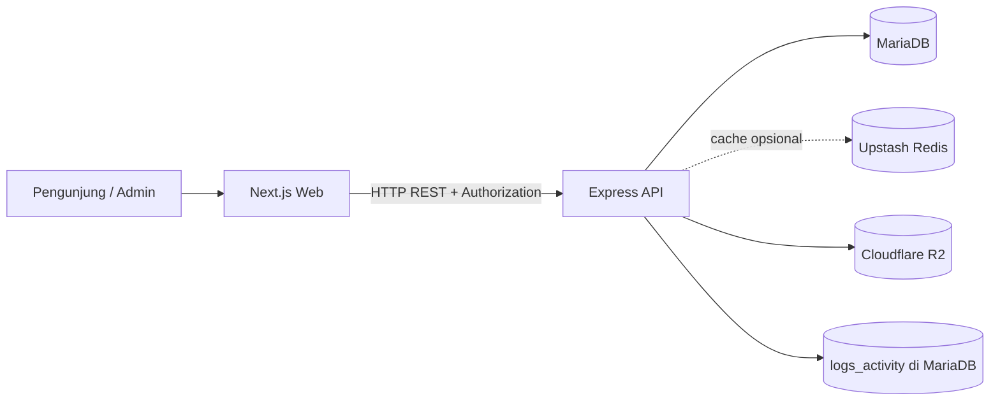
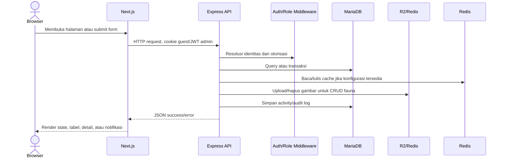
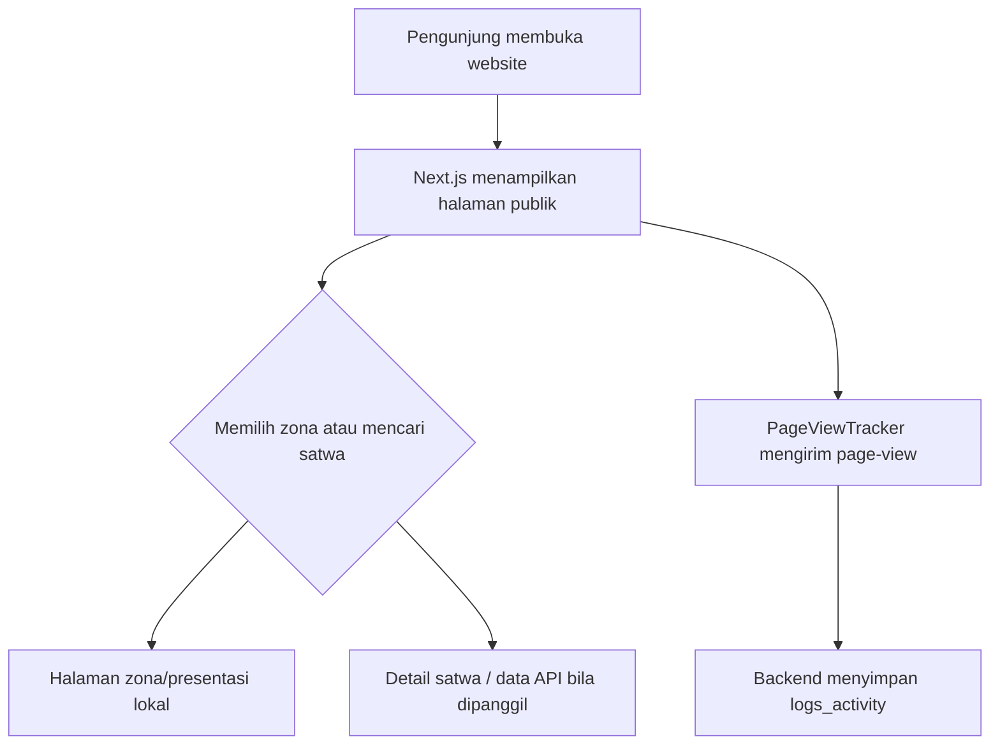
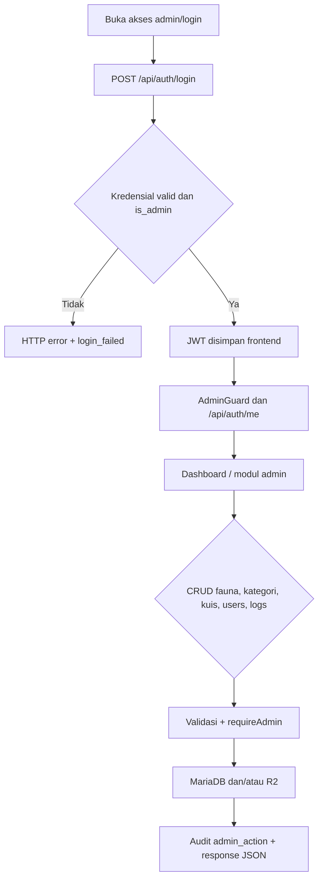
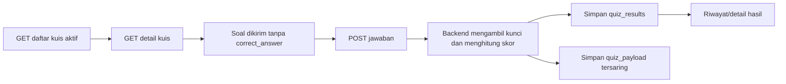

# Analisis Arsitektur Sistem Website SATWA LYAR

## 1. Pendahuluan

Dokumen ini menganalisis kondisi aktual source code SATWA LYAR pada workspace saat pemeriksaan dilakukan. Analisis bersifat read-only dan didasarkan pada source code, konfigurasi, README, route, middleware, schema SQL, serta komponen frontend yang tersedia.

Batasan analisis:

- Tidak dilakukan instalasi dependency, koneksi ke layanan eksternal, atau pengujian deployment.
- Tidak diasumsikan bahwa fitur yang hanya disebut pada README sudah tersedia pada UI.
- Nilai rahasia, password, token, dan credential tidak dicantumkan.
- Status “sudah” berarti terdapat implementasi yang dapat ditelusuri pada source code; status operasional produksi tetap memerlukan pengujian lingkungan.

## 2. Gambaran Umum Sistem

SATWA LYAR adalah monorepo edukasi fauna dengan dua aplikasi utama:

| Bagian | Implementasi aktual | Peran |
|---|---|---|
| Frontend | Next.js App Router, React, TypeScript | Halaman publik dan panel administrasi |
| Backend | Express.js, TypeScript | REST API, autentikasi, validasi, bisnis, logging |
| Database | MariaDB melalui driver `mariadb` | Penyimpanan data relasional |
| Cache | Upstash Redis REST, opsional | Cache kategori dan daftar fauna tertentu |
| Object storage | Cloudflare R2 melalui AWS S3 SDK | Penyimpanan gambar satwa |
| Deployment yang dikonfigurasi | Vercel | Frontend dan API sebagai project/target terpisah yang dapat dikonfigurasi |

Model identitas backend membedakan Guest dan Admin. Guest dibuat otomatis oleh middleware melalui cookie dan digunakan untuk tracking, favorit, serta hasil kuis. Admin login memakai email/password dan JWT. Di sisi frontend, panel admin menyimpan JWT pada `localStorage`.



## 3. Struktur Proyek

### 3.1 Struktur tingkat atas

```text
SATWA-LYAR/
├── apps/
│   ├── api/                 Backend Express + TypeScript
│   └── web/                 Frontend Next.js App Router
├── package.json             Workspace dan script orkestrasi
├── package-lock.json        Lock dependency root
├── README.md                Gambaran sistem dan setup
└── .gitignore
```

### 3.2 Backend (`apps/api`)

| Direktori/file | Fungsi |
|---|---|
| `src/app.ts` | Membuat Express app, middleware keamanan, parser, logger, route, handler error |
| `src/server.ts` | Entry point server lokal dan export app untuk serverless |
| `src/config/` | Pool MariaDB, konfigurasi R2, dan Redis |
| `src/middleware/` | Request ID, konteks guest, autentikasi, role admin, validasi, activity log, error |
| `src/modules/` | Modul domain: animals, categories, auth, favorites, quiz, users, logs, track, dashboard |
| `src/database/schema.sql` | Baseline tabel, indeks, foreign key, seed kategori dan admin |
| `src/database/migrations/` | Migrasi identitas users dan activity logs |
| `src/database/init-db.ts` | Inisialisasi schema |
| `src/database/migrate.ts` | Runner migrasi dan tabel `schema_migrations` |
| `src/database/prune-logs.ts` | Retensi/pembersihan log |
| `src/utils/` | Cookie, hash session, public ID |
| `src/types/express.d.ts` | Perluasan tipe request Express |
| `.env.example` | Template konfigurasi tanpa nilai rahasia |
| `vercel.json` | Konfigurasi deployment Vercel |
| `package.json`, `tsconfig.json` | Dependency, script, dan compiler TypeScript |

Pola modul backend umumnya memisahkan `routes`, `controller`, `validation`, dan pada log terdapat `repository` serta `service`. Query SQL masih berada langsung di controller/service, sehingga belum merupakan pemisahan repository yang konsisten di seluruh modul.

### 3.3 Frontend (`apps/web`)

| Direktori/file | Fungsi |
|---|---|
| `app/` | Route halaman App Router, termasuk landing, zona fauna, detail satwa, login, dan admin |
| `app/admin/` | Dashboard, fauna, kategori, kuis, users, dan logs |
| `components/` | Komponen UI, form fauna, tabel, guard, layout admin, chart, tracking |
| `context/AuthContext.tsx` | State sesi admin dan verifikasi `/api/auth/me` |
| `lib/api.ts` | Client API terpusat, token, normalisasi data, endpoint admin |
| `lib/types.ts` | Kontrak tipe data frontend |
| `lib/analytics.ts` | Mengambil dan mengelompokkan page-view untuk chart dashboard |
| `lib/exhibits.ts`, `navigation.ts`, `utils.ts` | Data navigasi, utilitas, dan konfigurasi presentasi |
| `public/` | Asset lokal |
| `next.config.ts` | Konfigurasi Next.js |
| `AGENTS.md` | Aturan khusus proyek Next.js |

Tidak ditemukan `app/admin/layout.tsx`; layout admin dirakit melalui `AdminLayout` dan `AdminGuard` pada halaman/komponen yang relevan.

## 4. Technology Stack

| Teknologi | Bukti source/config | Fungsi |
|---|---|---|
| TypeScript | `tsconfig.json`, file `.ts/.tsx` | Bahasa utama dan type safety |
| Next.js 16.4.2 | `apps/web/package.json` | Framework frontend/App Router |
| React 19.3.0 | `apps/web/package.json` | Komponen dan state UI |
| Tailwind CSS 4 | dependency frontend dan class utility | Styling responsif |
| Lucide React | dependency frontend | Ikon UI |
| Recharts | dependency frontend | Chart dashboard |
| Express 4.19.2 | `apps/api/package.json` | HTTP REST API |
| MariaDB 3.3.1 driver | `mariadb` dan `schema.sql` | Koneksi ke MariaDB Cloud |
| bcryptjs | backend auth/users | Hash dan verifikasi password |
| jsonwebtoken | backend auth | JWT admin |
| express-validator | validation files | Validasi dan sanitasi input |
| Helmet, CORS | `app.ts` | Header keamanan dan kontrol origin |
| express-rate-limit | `app.ts` | Rate limit global dan login |
| multer | animals routes | Upload gambar multipart ke memory |
| AWS S3 SDK | `config/r2.ts` | Akses Cloudflare R2 yang kompatibel S3 |
| Upstash Redis REST | `config/redis.ts` | Cache opsional dan invalidasi versi |
| Morgan | `app.ts` | Logging request ke stdout |
| Vercel | `vercel.json`, server export, README | Deployment yang ditargetkan |
| `tsx`, TypeScript, ESLint | package files | Development, build, lint |

Teknologi pihak ketiga yang terlihat dari source: MariaDB Cloud, Cloudflare R2, Upstash Redis, Vercel, serta gambar eksternal/Unsplash dan media URL pada halaman publik. Ketersediaan aktual layanan tersebut belum diuji dari workspace.

## 5. Arsitektur Sistem

### 5.1 Pola arsitektur

Arsitektur aktual dapat dikategorikan sebagai monorepo multi-aplikasi dengan client-server dan REST API. Backend memakai modular monolith: satu Express app memuat beberapa modul domain, middleware lintas modul, serta akses database bersama. Frontend memakai Next.js App Router dengan halaman client-side untuk interaksi admin dan beberapa halaman publik.

### 5.2 Urutan request backend

Urutan middleware yang terlihat:

```text
Request ID → Helmet/CORS → rate limit → body parser → Morgan
→ guestContext → activityLogger → route middleware/validation
→ controller/service → notFound/error handler
```

`guestContext` memulihkan admin dari JWT atau membuat/resolusi Guest dari cookie. `activityLogger` merekam aktivitas request ke `logs_activity`. Route admin kemudian menerapkan `authenticate` dan `requireAdmin`.

### 5.3 Aliran data utama



Cache yang terdokumentasi di backend berlaku untuk `GET /api/categories` dan sebagian `GET /api/animals`; perubahan admin menaikkan versi cache. Jika konfigurasi Redis kosong, aplikasi dirancang tetap berjalan tanpa cache.

### 5.4 Health check dan deployment

`GET /api/health` menguji `SELECT 1` ke database dan mengembalikan status 200/503. `server.ts` menjalankan listener lokal pada port default 5000 saat bukan Vercel dan mengekspor app untuk runtime serverless. Frontend menggunakan relative URL di browser dan fallback `NEXT_PUBLIC_API_URL` pada server-side.

## 6. Business Workflow

### 6.1 Aktor

| Aktor | Aktivitas yang terverifikasi |
|---|---|
| Pengunjung/Guest | Membuka landing/zona, melihat satwa, tracking page view, dapat memiliki identitas guest backend |
| Pengguna beridentitas guest | Favorit dan submit/riwayat kuis melalui endpoint yang memakai `authenticate` |
| Administrator | Login, melihat dashboard, mengelola fauna/kategori/kuis/admin, membaca log |
| Sistem | Membuat guest, mencatat request/audit/error, mengelola cache dan public ID admin |

Catatan: belum ada bukti pada frontend yang dibaca bahwa seluruh workflow guest favorit/kuis/profil telah memiliki halaman UI lengkap.

### 6.2 Workflow eksplorasi



### 6.3 Workflow admin



### 6.4 Workflow kuis backend



## 7. Analisis Database

### 7.1 Entitas dan atribut penting

| Tabel | Primary key | Foreign key/relasi | Atribut penting |
|---|---|---|---|
| `users` | `id` | Direferensikan favorites, results, logs | `public_id`, `name`, `email`, `password` hash, `is_admin`, timestamp |
| `categories` | `id` | Direferensikan animals, quizzes | `name`, `slug`, `description`, `icon` |
| `animals` | `id` | `category_id → categories.id` | nama, nama ilmiah, deskripsi, ciri, habitat, makanan, status konservasi, `image_key` |
| `favorites` | `id` | `user_id`, `animal_id` | pasangan unik user-satwa, timestamp |
| `quizzes` | `id` | `category_id → categories.id`, nullable | judul, deskripsi, `is_active` |
| `quiz_questions` | `id` | `quiz_id → quizzes.id` | teks, opsi A-D, kunci, urutan |
| `quiz_results` | `id` | `user_id`, `quiz_id` | skor, total soal, jawaban benar, waktu selesai |
| `logs_activity` | `id` | `user_id → users.id`, nullable | request, aktor, event, endpoint, status, durasi, payload tersaring, error |
| `admin_counters` | `name` | Tidak ada | counter transaksional public ID admin |
| `schema_migrations` | `version` | Dibuat migration runner | versi migrasi yang sudah diterapkan |

### 7.2 ERD

```mermaid
erDiagram
    USERS ||--o{ FAVORITES : memiliki
    ANIMALS ||--o{ FAVORITES : difavoritkan
    CATEGORIES ||--o{ ANIMALS : mengelompokkan
    CATEGORIES o|--o{ QUIZZES : mengelompokkan
    QUIZZES ||--o{ QUIZ_QUESTIONS : memiliki
    USERS ||--o{ QUIZ_RESULTS : memperoleh
    QUIZZES ||--o{ QUIZ_RESULTS : menghasilkan
    USERS o|--o{ LOGS_ACTIVITY : menjadi_aktor

    USERS { int id PK; string public_id UK; string email UK; boolean is_admin }
    CATEGORIES { int id PK; string name; string slug UK }
    ANIMALS { int id PK; int category_id FK; string name; string conservation_status; string image_key }
    FAVORITES { int id PK; int user_id FK; int animal_id FK }
    QUIZZES { int id PK; int category_id FK; string title; boolean is_active }
    QUIZ_QUESTIONS { int id PK; int quiz_id FK; string question_text; string correct_answer }
    QUIZ_RESULTS { int id PK; int user_id FK; int quiz_id FK; int score }
    LOGS_ACTIVITY { bigint id PK; int user_id FK; string event_type; string endpoint; datetime created_at }
```

Foreign key policy yang terlihat: favorites dan quiz results ikut terhapus ketika user terkait dihapus; favorites dan quiz questions cascade terhadap parent masing-masing; animals mencegah penghapusan kategori yang masih dipakai; quiz category menjadi NULL jika kategori dihapus; log user menjadi NULL.

## 8. Analisis Fitur dan Modul

### 8.1 Sudah terimplementasi pada backend

| Fitur | Frontend terkait | Backend/data | Status |
|---|---|---|---|
| Landing dan navigasi publik | `app/page.tsx`, navbar, footer | Presentasi lokal; beberapa URL gambar eksternal | Backend coupling tidak seragam |
| Browse/detail fauna | halaman zona, `app/satwa/[id]`, `animalsApi` | `GET /api/animals`, detail, filter/pagination | Backend siap; sebagian halaman zona tampak memakai data lokal |
| Kategori/zona | halaman zona, admin categories | public/admin category routes, `categories` | Backend siap; 4 seed kategori |
| Login/logout admin | `akses-admin`, `login`, `AuthContext` | JWT, bcrypt, `/api/auth/*` | Terimplementasi |
| Guard panel admin | `AdminGuard`, `AdminLayout` | middleware auth + role | Terimplementasi |
| CRUD fauna dan gambar | `admin/animals`, `AnimalForm`, crop dialog | MariaDB + multer + R2 | Terimplementasi |
| CRUD kategori | `admin/categories` | categories controller/routes | Terimplementasi |
| Dashboard statistik | `admin/dashboard`, charts | dashboard endpoint dan logs | Terimplementasi; chart page-view mengambil log berpaginasi |
| CRUD kuis/bank soal | `admin/quiz` | quiz admin routes dan tabel kuis | Backend + UI admin terverifikasi |
| Manajemen admin | `admin/users` | users routes, bcrypt, counter `adm_XXXX` | Terimplementasi |
| Activity/audit log | `admin/logs`, `lib/analytics.ts` | `logs_activity`, logs routes/service | Terimplementasi |
| Tracking page view | `PageViewTracker` | `POST /api/track/page-view` | Terimplementasi, best-effort |
| Profil admin | API profile dan halaman login/context | `/api/users/profile`, password | Backend terverifikasi; UI profil khusus tidak terverifikasi |

### 8.2 Terimplementasi di backend tetapi UI publik belum dapat diverifikasi lengkap

| Fitur | Bukti backend | Catatan |
|---|---|---|
| Favorit satwa | favorites routes/controller/schema | Tidak ditemukan halaman publik khusus favorit dalam daftar route frontend |
| Pengerjaan kuis pengguna | quiz user routes/controller/schema | UI pengguna untuk mengambil, submit, dan riwayat belum teridentifikasi |
| Profil guest/pengguna | guest context dan user profile routes | Frontend context berfokus pada admin |
| Cache Redis | `config/redis.ts` dan pemanggilan controller | Operasional tergantung env dan layanan eksternal |

### 8.3 Belum dapat diverifikasi atau perlu konfirmasi

| Area | Temuan |
|---|---|
| Deployment produksi | Konfigurasi Vercel ada, tetapi URL, environment, database, R2, dan Redis aktif tidak diuji |
| Isi database aktual | Schema/seed tersedia, tetapi jumlah/data fauna aktual tidak dapat dipastikan dari source |
| Pengujian runtime | Script `validate` tersedia, tetapi tidak dijalankan karena dapat memerlukan database dan perubahan/akses lingkungan |
| Kategori Farm House | Ada route/presentasi `/farmhouse`, tetapi bukan salah satu dari empat kategori seed dan hubungan ke API belum terverifikasi |

## 9. API dan Komunikasi Sistem

### 9.1 Endpoint publik/user

| Method | Endpoint | Akses | Fungsi |
|---|---|---|---|
| GET | `/` | Publik | Informasi API |
| GET | `/api/health` | Publik | Health check database |
| POST | `/api/auth/login` | Publik | Login admin; body email/password tervalidasi |
| POST | `/api/auth/logout` | Identitas | Logout dan audit |
| GET | `/api/auth/me` | Identitas | Identitas aktif |
| POST | `/api/track/page-view` | Publik | Mencatat page view |
| GET | `/api/animals` | Publik/optional auth | List, search, filter, sort, pagination |
| GET | `/api/animals/:id` | Publik/optional auth | Detail dan status favorit |
| GET | `/api/categories` | Publik | Daftar kategori |
| GET | `/api/categories/:identifier` | Publik | Detail kategori via ID/slug |
| GET | `/api/favorites` | Identitas | Daftar favorit |
| GET | `/api/favorites/check/:animalId` | Identitas | Status favorit |
| POST | `/api/favorites`, `/api/favorites/:animalId` | Identitas | Tambah favorit |
| DELETE | `/api/favorites/:animalId` | Identitas | Hapus favorit |
| GET | `/api/quiz` | Publik | Daftar kuis aktif |
| GET | `/api/quiz/:id` | Publik | Soal tanpa kunci jawaban |
| POST | `/api/quiz/:id/submit` | Identitas | Hitung dan simpan hasil |
| GET | `/api/quiz/history` | Identitas | Riwayat hasil |
| GET | `/api/quiz/results/:id` | Identitas | Detail hasil |
| GET | `/api/users/profile` | Identitas | Profil dan statistik |
| PUT | `/api/users/profile` | Admin | Ubah nama profil |
| PUT | `/api/users/password` | Admin | Ganti password dengan verifikasi lama |

### 9.2 Endpoint admin

| Resource | Endpoint dan method |
|---|---|
| Dashboard | `GET /api/admin/dashboard` |
| Categories | `GET/POST /api/admin/categories`, `GET/PUT/DELETE /api/admin/categories/:id` |
| Animals | `GET/POST /api/admin/animals`, `GET/PUT/DELETE /api/admin/animals/:id`, `DELETE /api/admin/animals/:id/image` |
| Quiz | `GET/POST /api/admin/quiz`, `GET/PUT/DELETE /api/admin/quiz/:id` |
| Questions | `POST /api/admin/quiz/:id/questions`, `PUT/DELETE /api/admin/quiz/:id/questions/:qid` |
| Users | `GET/POST /api/admin/users`, `GET/PUT/DELETE /api/admin/users/:id` |
| Logs | `GET /api/admin/logs`, `GET /api/admin/logs/summary` |

Parameter query yang terlihat antara lain `page`, `limit`, `search`, `category_id`, `zone`, `status`, `sort`, `scope`, `event_type`, `actor_type`, `action`, `endpoint`, `from`, `to`, `q`, dan `days`. Validasi body/parameter menggunakan `express-validator`; upload fauna memakai `multipart/form-data` dengan batas 5 MB serta tipe gambar tertentu.

### 9.3 Format response dan error

Client frontend mengharapkan response JSON dengan pola `data`, `pagination`, `success`, dan `message` sesuai endpoint. `apiRequest` mem-parsing JSON, mengubah HTTP non-2xx menjadi `ApiError`, dan memicu penghapusan sesi pada 401/403. Backend memiliki not-found dan global error handler serta mencatat application error. Detail seluruh schema response perlu dikonfirmasi melalui pengujian kontrak/API aktual.

## 10. Security dan User Access

### 10.1 Mekanisme yang diterapkan

- Password admin di-hash memakai bcryptjs dengan cost 12.
- JWT dipakai sebagai token sesi admin dan dikirim frontend melalui header `Authorization: Bearer`.
- Guest memakai cookie identitas; cookie tersebut bukan password atau token admin.
- `authenticate` memeriksa identitas; `requireAdmin` memeriksa `is_admin` dan mencatat akses ditolak.
- Helmet, CORS credentials, rate limit global 100 request/15 menit, dan rate limit auth 15 request/15 menit diterapkan di `app.ts`.
- Input divalidasi dengan express-validator.
- Payload log disaring; dokumentasi backend menyatakan password, token, cookie mentah, dan kunci jawaban tidak disimpan.
- Request ID dan hash session dipakai untuk korelasi tanpa menyimpan token mentah.

### 10.2 Risiko/hal yang perlu ditinjau

1. JWT disimpan pada `localStorage`, sehingga dampak XSS dapat lebih besar daripada cookie `HttpOnly`. Perlu evaluasi migrasi ke cookie sesi `HttpOnly`, `Secure`, dan kebijakan CSRF yang sesuai.
2. `express.json` dan `urlencoded` diberi limit 10 MB secara global; perlu dipastikan sesuai kebutuhan endpoint dan tidak memperbesar permukaan DoS.
3. IP, user-agent, endpoint, dan payload log mengandung data operasional/berpotensi personal; retensi, akses, dan kebijakan privasi perlu ditetapkan.
4. Seed database memiliki akun admin awal yang harus dipastikan tidak digunakan di produksi dan password-nya segera diganti. Nilai credential sengaja tidak dicantumkan di dokumen ini.
5. CORS bergantung pada `CORS_ORIGIN`; konfigurasi produksi harus diverifikasi agar tidak terlalu longgar.
6. Upload dibatasi MIME dan ukuran, tetapi validasi isi file, antivirus, dan kebijakan nama/key R2 perlu ditinjau untuk hardening.
7. Tidak terlihat bukti pengujian keamanan otomatis, secret rotation, backup/restore, atau observability eksternal dari source yang diperiksa.

## 11. System Requirements

### 11.1 Software requirements yang didukung source

| Komponen | Temuan |
|---|---|
| Runtime | Node.js `>=18.0.0` pada backend; versi Node frontend tidak dinyatakan eksplisit |
| Package manager | npm/workspaces, dibuktikan package lock dan script workspace |
| Frontend framework | Next.js 16.4.2, React 19.3.0 |
| Backend framework | Express 4.19.2 + TypeScript |
| Database | MariaDB; koneksi dikonfigurasi melalui env |
| Browser | Browser modern dengan JavaScript, Fetch, `localStorage`, dan dukungan UI responsif |
| External services | Vercel, Cloudflare R2, Upstash Redis opsional |
| Development tools | npm, TypeScript, `tsx`, ESLint, dan concurrently |

Versi OS, versi browser minimum, ukuran RAM/CPU, dan kapasitas storage tidak dapat ditetapkan secara akurat hanya dari source code.

### 11.2 Hardware requirements

Source tidak memberikan hasil benchmark atau kapasitas beban. Oleh karena itu tidak ditetapkan angka minimum CPU/RAM/storage. Kebutuhan aktual harus diturunkan dari jumlah admin, trafik publik, ukuran gambar, ukuran log, dan target concurrency.

### 11.3 Network requirements

- Browser perlu akses HTTPS ke frontend dan API/dependency eksternal pada deployment.
- Development menggunakan frontend default Next.js dan API port 5000 menurut README/script; port frontend default Next.js tidak dikustomisasi pada file yang diperiksa.
- API memakai HTTP REST, JSON, multipart upload, CORS credentials, cookie guest, dan header Authorization.
- Backend membutuhkan koneksi keluar ke MariaDB; R2 dan Redis hanya diperlukan bila fitur tersebut dikonfigurasi.

## 12. Non-Functional Requirements

| Aspek | Sudah diterapkan | Rekomendasi/konfirmasi |
|---|---|---|
| Performance | Pagination, indeks database, FULLTEXT fauna, cache Redis opsional | Benchmark query, cache hit ratio, dan load test belum ada |
| Reliability | Health check, global error handler, request timeout/error path pada client | Tambahkan retry policy terukur, backup DB, dan uji pemulihan |
| Security | JWT, bcrypt, role guard, Helmet, CORS, rate limit, validation, redacted log | Review XSS/localStorage, upload hardening, secret rotation, CSRF model |
| Maintainability | TypeScript, modular routes/controllers, centralized API client, migrations | Konsistensikan repository/service dan tambahkan test/unit contract |
| Scalability | Stateless API target serverless, pagination, Redis opsional, R2 untuk media | Verifikasi pool DB, concurrency, serverless cold start, dan batas layanan |
| Usability | Responsive UI, loading/error/empty states, navigasi admin | Uji aksesibilitas, keyboard, kontras, dan user flow publik |
| Availability | Target deployment Vercel, health endpoint | SLA, monitoring, alerting, fallback layanan, dan backup belum terverifikasi |

## 13. Identifikasi Kebutuhan UML

Diagram berikut relevan untuk tahap perancangan berikutnya:

| Diagram | Aktor/objek/proses yang perlu dimodelkan |
|---|---|
| Use Case | Pengunjung, Guest, Admin, Sistem; browse/filter/detail fauna, favorit, kuis, login, CRUD admin, logs |
| Activity | Login admin, eksplorasi fauna, submit kuis, CRUD fauna dengan upload, pencatatan page view |
| Sequence | Browser–Next.js–API–middleware–MariaDB untuk login, detail fauna, submit kuis, dan CRUD fauna/R2 |
| Class | User/Guest/Admin, Category, Animal, Favorite, Quiz, Question, QuizResult, ActivityLog; controller/service/repository |
| Component | Next.js UI, API routes, auth middleware, domain modules, DB adapter, Redis adapter, R2 adapter, logging |
| Deployment | Browser, Vercel Web, Vercel API/serverless, MariaDB Cloud, Upstash Redis, Cloudflare R2 |

Prioritas awal: Use Case dan Activity untuk kebutuhan bisnis; Component dan Deployment untuk arsitektur; Sequence untuk empat alur kritis; Class setelah kontrak domain dan repository dipastikan.

## 14. Kesimpulan

SATWA LYAR telah memiliki fondasi arsitektur modular monorepo yang jelas: Next.js sebagai web client, Express sebagai REST API, MariaDB sebagai database utama, serta integrasi opsional Redis dan R2. Backend mencakup kontrol akses admin, identitas guest, CRUD konten, kuis, favorit, tracking, audit log, validasi, dan proteksi request.

Temuan paling penting untuk dokumentasi akademis adalah pemisahan antara kemampuan backend dan UI aktual. Panel admin dan halaman detail/eksplorasi tertentu dapat ditelusuri pada frontend, sedangkan UI publik untuk favorit, kuis pengguna, dan profil belum terbukti lengkap dari file yang diperiksa. Selain itu, route `/farmhouse` hadir sebagai presentasi frontend tetapi tidak tercermin pada empat kategori seed backend.

## 15. Catatan dan Hal yang Perlu Dikonfirmasi

1. Apakah database produksi benar-benar MariaDB Cloud dan apakah seluruh tabel baseline/migrasi sudah diterapkan?
2. Apa URL deployment resmi frontend/API dan bagaimana environment production di Vercel diatur?
3. Apakah Cloudflare R2 dan Upstash Redis aktif di production, atau hanya integrasi opsional?
4. Apakah data halaman zona saat ini memang sengaja statis, atau seharusnya seluruhnya mengambil data API?
5. Apakah fitur favorit, kuis pengguna, riwayat nilai, dan profil akan dibuatkan halaman frontend publik?
6. Apakah `/farmhouse` merupakan zona resmi baru, konten statis, atau halaman prototipe yang belum terhubung ke kategori backend?
7. Berapa target pengguna, concurrency, ukuran gambar, retensi log, dan SLA sehingga spesifikasi hardware, performance, dan availability dapat dihitung?
8. Apakah akun seed awal telah dinonaktifkan/dirotasi pada lingkungan non-development?
9. Apakah perlu penambahan automated test untuk API contract, authorization matrix, upload, dan recovery database?
10. Sebelum publikasi laporan, lakukan verifikasi runtime terhadap endpoint, response schema, konfigurasi deployment, serta nama organisasi/produk yang masih muncul sebagai teks presentasi pada halaman publik bila tidak sesuai identitas SATWA LYAR.

### Daftar file yang diperiksa

File utama yang menjadi dasar analisis:

- `README.md`, `package.json`, `package-lock.json`
- `apps/api/README.md`, `apps/api/package.json`, `apps/api/.env.example`, `apps/api/vercel.json`, `apps/api/tsconfig.json`
- `apps/api/src/app.ts`, `server.ts`, `config/*`, `middleware/*`, `utils/*`, `types/express.d.ts`
- Seluruh route/controller/validation/service/repository pada `apps/api/src/modules/*`
- `apps/api/src/database/schema.sql`, `init-db.ts`, `migrate.ts`, `prune-logs.ts`, dan `migrations/*`
- `apps/web/package.json`, `apps/web/.env.example`, `apps/web/next.config.ts`, `apps/web/tsconfig.json`, `apps/web/AGENTS.md`
- `apps/web/app/**/*`, `apps/web/components/**/*`, `apps/web/context/**/*`, `apps/web/lib/**/*`, `apps/web/hooks/**/*`
- Asset dan file konfigurasi frontend yang terdaftar melalui `rg --files`

Dokumen ini dibuat berdasarkan snapshot source code pada saat analisis dan perlu diperbarui apabila route, schema, environment, atau implementasi frontend berubah.
