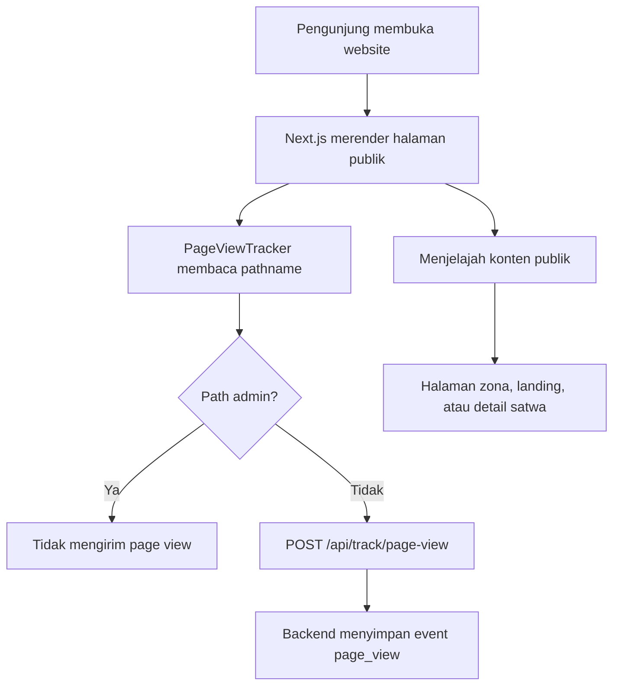
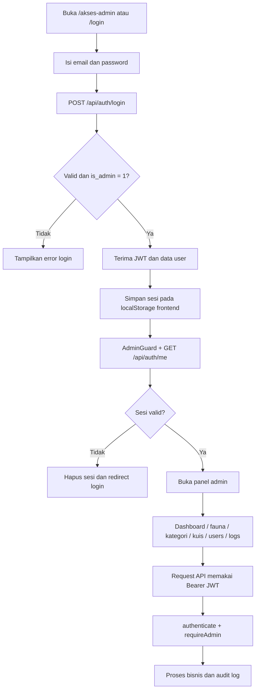
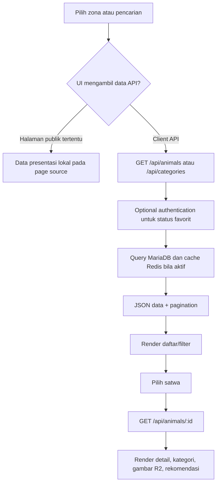
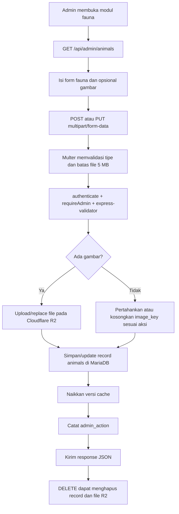
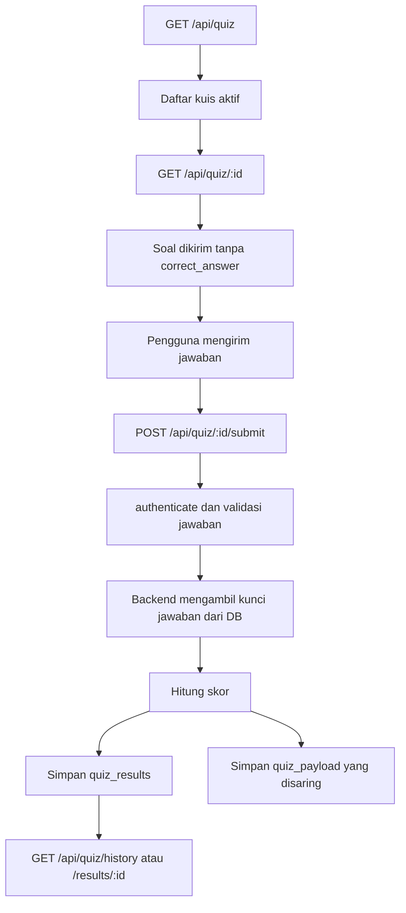

# 01 — Business Workflow SATWA LYAR

Diagram berikut memisahkan workflow yang terlihat pada frontend dan workflow yang tersedia pada backend. Page view tidak berlaku pada `/akses-admin` dan `/admin` karena `PageViewTracker` mengecualikan prefix tersebut.

## Workflow pengunjung

## Workflow administrator

## Workflow eksplorasi fauna

## Workflow pengelolaan data fauna

## Workflow kuis

Backend mendukung workflow ini. UI frontend pengguna untuk alur tersebut belum terverifikasi; UI yang teridentifikasi adalah manajemen kuis admin.

## Catatan validasi

- Backend menyediakan fitur guest, favorit, kuis, profil, dan tracking.
- Frontend yang dapat diverifikasi jelas menyediakan panel admin, detail satwa, page-view tracker, dan client API admin/public animals.
- Halaman zona dan landing mengandung data presentasi lokal; keterhubungan setiap kartu zona ke endpoint publik tidak seragam.
- `/farmhouse` ada sebagai route frontend, tetapi tidak termasuk empat kategori seed pada schema SQL.
