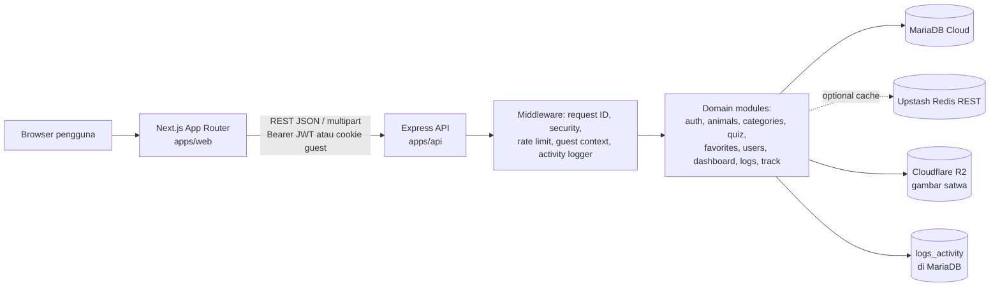
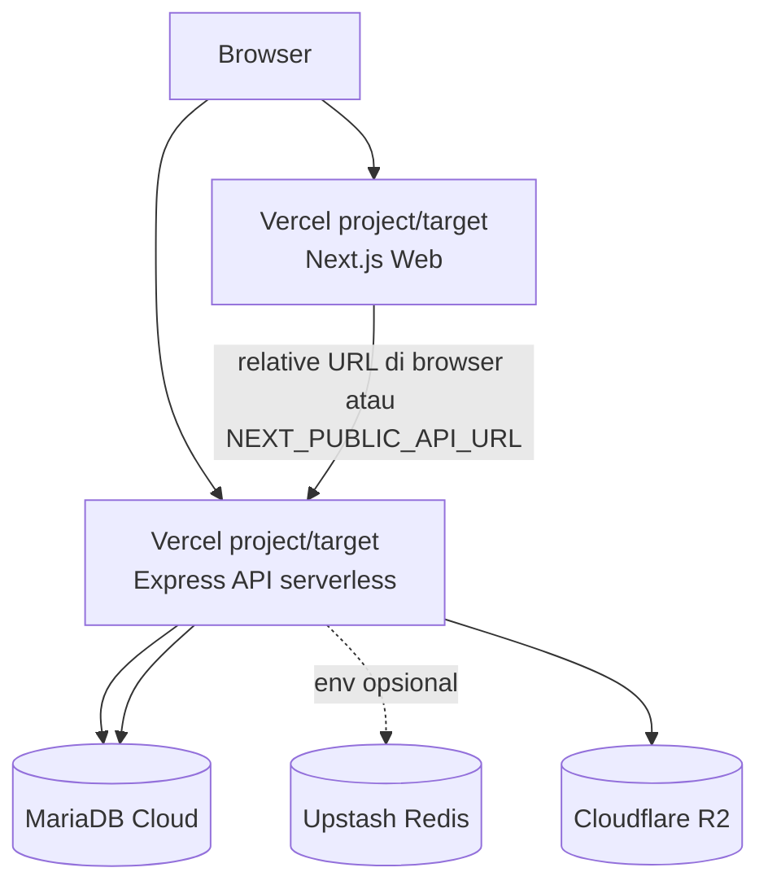
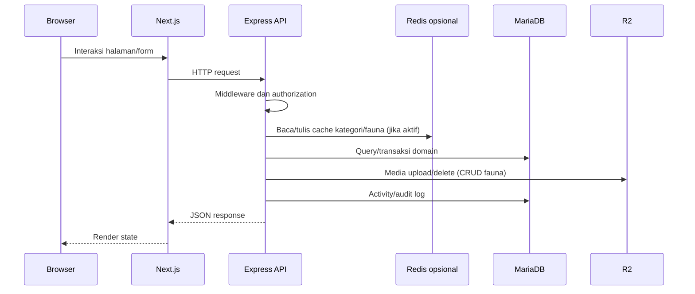

# 02 — System Architecture SATWA LYAR

## Gambaran keseluruhan

## Deployment architecture aktual berdasarkan konfigurasi

`server.ts` menjalankan listener lokal pada port 5000 jika bukan lingkungan Vercel dan mengekspor Express app untuk target serverless. `vercel.json` tersedia pada API. Nama project Vercel dan topologi produksi aktual belum dapat diverifikasi tanpa akses deployment.

## Hubungan request dan data

## Batas validasi

- MariaDB adalah persistence utama berdasarkan driver, schema, dan query.
- Redis hanya fallback cache opsional; source menyatakan aplikasi tetap berjalan tanpa konfigurasi Redis.
- R2 digunakan untuk `image_key` dan URL gambar fauna.
- Tidak ada bukti queue, microservice, atau message broker.
- Status deployment, environment production, dan konektivitas layanan eksternal belum diuji.
