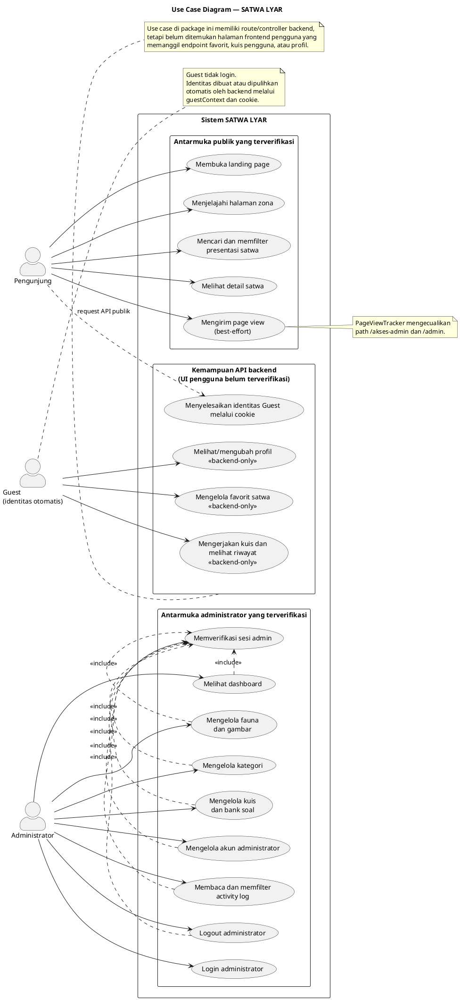

# 03 — Use Case Diagram SATWA LYAR

Dokumen ini direvisi berdasarkan pemeriksaan langsung terhadap source code, bukan hanya dokumentasi arsitektur sebelumnya. Pemeriksaan mencakup halaman dan komponen `apps/web`, API client frontend, seluruh route/controller backend, middleware identitas, serta schema database.

Temuan penting:

- Pengunjung dapat membuka halaman publik, menjelajahi halaman zona, melakukan pencarian/filter pada UI yang tersedia, melihat detail satwa, dan secara otomatis tercatat melalui page-view tracker.
- Login yang memiliki antarmuka frontend adalah login Administrator melalui `/akses-admin` dan `/login`.
- Guest bukan aktor yang melakukan login. Backend membuat atau memulihkan identitas Guest melalui cookie pada `guestContext`.
- Panel Administrator memiliki UI untuk dashboard, fauna, kategori, kuis, akun administrator, activity log, dan logout.
- Backend memiliki endpoint favorit, kuis pengguna, dan profil, tetapi tidak ditemukan halaman frontend pengguna yang memanggil endpoint tersebut. Karena itu use case tersebut ditampilkan terpisah sebagai kemampuan backend yang belum terbukti memiliki UI.

## 2. PlantUML Use Case Diagram

Kode berikut menggunakan notasi UML Use Case dengan system boundary, aktor, use case, dan relasi `<<include>>`. Use case backend-only diberi stereotype agar tidak disalahartikan sebagai fitur frontend yang sudah selesai.

## 3. Aktor sistem

| Aktor | Definisi aktual | Interaksi yang digambarkan | Dasar source |
|---|---|---|---|
| Pengunjung | Pengguna yang mengakses website tanpa login | Landing, zona, pencarian/filter presentasi, detail satwa, page view | `apps/web/app/page.tsx`, `airtawar/page.tsx`, `serangga/page.tsx`, `reptils/page.tsx`, `burung/page.tsx`, `farmhouse/page.tsx`, `satwa/[id]/page.tsx`, `components/PageViewTracker.tsx` |
| Guest | Identitas backend dengan `is_admin = 0`, `public_id` guest, tanpa email/password | Resolusi identitas otomatis; kemampuan favorit/kuis/profil hanya dicatat sebagai backend-only | `apps/api/src/middleware/guest-context.middleware.ts`, `auth.middleware.ts`, `database/schema.sql` |
| Administrator | Pengguna dengan `is_admin = 1` dan kredensial admin | Login, sesi, dashboard, CRUD fauna/kategori/kuis/admin, log, logout | `apps/web/app/akses-admin/page.tsx`, `app/login/page.tsx`, `context/AuthContext.tsx`, `components/AdminGuard.tsx`, route admin backend |

Guest bukan turunan atau hasil login Administrator. Administrator memperoleh identitas dari JWT, sedangkan Guest memperoleh identitas dari cookie yang dibuat oleh `guestContext`.

## 4. Use case Pengunjung yang terverifikasi melalui frontend

| Use case | Perilaku frontend | Endpoint/komponen pendukung | Status |
|---|---|---|---|
| Membuka landing page | Menampilkan hero, destinasi, ensiklopedia lokal, FAQ | `apps/web/app/page.tsx` | Terverifikasi |
| Menjelajahi halaman zona | Route `/airtawar`, `/serangga`, `/reptils`, `/burung`, dan `/farmhouse` | Page files terkait, navbar/navigation | Terverifikasi sebagai halaman frontend; tidak semua terbukti terhubung ke API |
| Mencari dan memfilter presentasi satwa | State pencarian/filter pada landing dan halaman zona | Page files terkait | Terverifikasi sebagai interaksi UI lokal |
| Melihat detail satwa | Route dinamis `/satwa/[id]` memanggil `animalsApi.getPublicById` | `apps/web/app/satwa/[id]/page.tsx`, `apps/web/lib/api.ts`, `GET /api/animals/:id` | Terverifikasi |
| Mengirim page view | `PageViewTracker` mengirim request setelah pathname berubah, kecuali area admin | `apps/web/app/layout.tsx`, `components/PageViewTracker.tsx`, `POST /api/track/page-view` | Terverifikasi, best-effort |

`GET /api/animals` dan `GET /api/categories` tersedia di backend, tetapi pemeriksaan halaman zona menunjukkan sebagian konten zona berupa data/presentasi yang didefinisikan di file page. Karena itu diagram tidak mengklaim semua tampilan zona selalu berasal dari database.

## 5. Use case Administrator yang terverifikasi melalui frontend

| Use case | Aktivitas | Endpoint utama | Dasar frontend |
|---|---|---|---|
| Login administrator | Submit email/password dan menerima JWT | `POST /api/auth/login` | `app/akses-admin/page.tsx`, `app/login/page.tsx`, `context/AuthContext.tsx`, `lib/api.ts` |
| Memverifikasi sesi admin | Memeriksa token saat aplikasi dimuat dan menolak non-admin | `GET /api/auth/me` | `AuthContext.tsx`, `AdminGuard.tsx` |
| Melihat dashboard | Statistik fauna, kategori, kuis, identitas, aktivitas | `GET /api/admin/dashboard`; log page-view untuk analytics | `app/admin/dashboard/*`, `lib/api.ts`, `lib/analytics.ts` |
| Mengelola fauna dan gambar | List, detail, tambah, ubah, hapus fauna, hapus gambar | `GET/POST/PUT/DELETE /api/admin/animals`, `DELETE /image` | `app/admin/animals/page.tsx`, `AnimalForm.tsx`, `AnimalTable.tsx`, dialog/crop components |
| Mengelola kategori | List, tambah, ubah, hapus kategori | `GET/POST/PUT/DELETE /api/admin/categories` | `app/admin/categories/page.tsx` |
| Mengelola kuis dan bank soal | CRUD kuis dan pertanyaan pilihan ganda | `/api/admin/quiz` dan nested `/questions` | `app/admin/quiz/page.tsx` |
| Mengelola akun administrator | List, tambah, ubah, hapus akun administrator | `GET/POST/PUT/DELETE /api/admin/users` | `app/admin/users/page.tsx` |
| Membaca dan memfilter activity log | Filter event/aktor/aksi dan detail log | `GET /api/admin/logs`, `GET /api/admin/logs/summary` | `app/admin/logs/page.tsx` |
| Logout administrator | Memanggil logout backend lalu membersihkan sesi lokal | `POST /api/auth/logout` | `AuthContext.tsx`, `lib/api.ts`, `lib/auth.ts` |

`PUT /api/users/profile` dan `PUT /api/users/password` tidak dimasukkan sebagai use case Administrator terverifikasi karena tidak ditemukan halaman frontend profil/password yang memanggilnya. Endpoint tersebut dicatat pada bagian backend-only.

## 6. Kemampuan backend tanpa UI frontend terverifikasi

Kemampuan berikut benar-benar tersedia pada route/controller backend, tetapi tidak ditemukan pemanggilan endpoint dari halaman frontend yang diperiksa:

| Kemampuan | Endpoint | Aktor backend | Bukti backend | Status UI |
|---|---|---|---|---|
| Mengelola favorit satwa | `GET/POST/DELETE /api/favorites`, `GET /check/:animalId` | Guest/admin yang memiliki identitas aktif | `modules/favorites/favorites.routes.ts`, controller, tabel `favorites` | Tidak terverifikasi |
| Mengerjakan kuis pengguna | `GET /api/quiz`, `GET /api/quiz/:id`, `POST /submit` | Guest/admin yang memiliki identitas aktif | `modules/quiz/quiz.user.routes.ts`, controller, tabel quiz/results | Tidak terverifikasi |
| Melihat riwayat/detail hasil kuis | `GET /api/quiz/history`, `GET /api/quiz/results/:id` | Guest/admin pemilik hasil atau admin sesuai controller | `quiz.user.routes.ts/controller` | Tidak terverifikasi |
| Melihat profil | `GET /api/users/profile` | Guest/admin beridentitas | `users.profile.routes.ts/controller` | Tidak terverifikasi |
| Mengubah profil/password | `PUT /api/users/profile`, `PUT /api/users/password` | Menurut controller: admin memiliki hak perubahan | `users.profile.routes.ts/controller` | Tidak terverifikasi |

Pemisahan ini penting untuk laporan: keberadaan endpoint dan tabel tidak cukup untuk menyimpulkan bahwa use case sudah tersedia sebagai antarmuka website.

## 7. Relasi UML yang digunakan

### 7.1 `<<include>>` sesi admin

Use case dashboard, CRUD admin, pembacaan log, dan logout mengikutsertakan verifikasi sesi karena route backend menerapkan `authenticate`; operasi administrasi juga menerapkan `requireAdmin`. Login menghasilkan sesi, sedangkan `GET /api/auth/me` digunakan frontend untuk memverifikasi sesi yang tersimpan.

### 7.2 Page view sebagai proses otomatis

Page view bukan aktivitas yang dipicu tombol khusus oleh Pengunjung. Use case tersebut tetap ditampilkan karena `PageViewTracker` secara otomatis mengirim request ketika halaman publik dibuka. Pengiriman bersifat best-effort dan tidak mengganggu rendering ketika request gagal.

### 7.3 Resolusi Guest

`guestContext` membuat Guest ketika request tidak memiliki Bearer JWT dan cookie Guest yang valid. Proses ini bukan login dan tidak boleh dimodelkan sebagai `Login Guest`. Diagram menggunakan relasi request dari Pengunjung ke use case resolusi identitas untuk menunjukkan proses sistem otomatis.

## 8. File sumber yang menjadi dasar

### Frontend

- `apps/web/app/page.tsx`
- `apps/web/app/airtawar/page.tsx`
- `apps/web/app/serangga/page.tsx`
- `apps/web/app/reptils/page.tsx`
- `apps/web/app/burung/page.tsx`
- `apps/web/app/farmhouse/page.tsx`
- `apps/web/app/satwa/[id]/page.tsx`
- `apps/web/app/akses-admin/page.tsx`
- `apps/web/app/login/page.tsx`
- `apps/web/app/admin/dashboard/page.tsx`
- `apps/web/app/admin/dashboard/DashboardClient.tsx`
- `apps/web/app/admin/animals/page.tsx`
- `apps/web/app/admin/categories/page.tsx`
- `apps/web/app/admin/quiz/page.tsx`
- `apps/web/app/admin/users/page.tsx`
- `apps/web/app/admin/logs/page.tsx`
- `apps/web/app/layout.tsx`
- `apps/web/components/PageViewTracker.tsx`
- `apps/web/components/AdminGuard.tsx`
- `apps/web/components/AdminLayout.tsx`
- `apps/web/context/AuthContext.tsx`
- `apps/web/lib/api.ts`
- `apps/web/lib/auth.ts`
- `apps/web/lib/analytics.ts`

### Backend

- `apps/api/src/app.ts`
- `apps/api/src/middleware/guest-context.middleware.ts`
- `apps/api/src/middleware/auth.middleware.ts`
- `apps/api/src/middleware/role.middleware.ts`
- `apps/api/src/modules/auth/*`
- `apps/api/src/modules/animals/*`
- `apps/api/src/modules/categories/*`
- `apps/api/src/modules/favorites/*`
- `apps/api/src/modules/quiz/*`
- `apps/api/src/modules/users/*`
- `apps/api/src/modules/dashboard/*`
- `apps/api/src/modules/logs/*`
- `apps/api/src/modules/track/*`
- `apps/api/src/database/schema.sql`

### Kesimpulan revisi

Diagram ini hanya menyatakan sebagai use case frontend apa yang memiliki halaman/komponen dan pemanggilan API yang dapat ditemukan. Fitur backend-only tetap didokumentasikan untuk menunjukkan kemampuan sistem aktual, tetapi diberi batas yang jelas agar tidak dianggap sebagai fitur antarmuka yang sudah tersedia.
