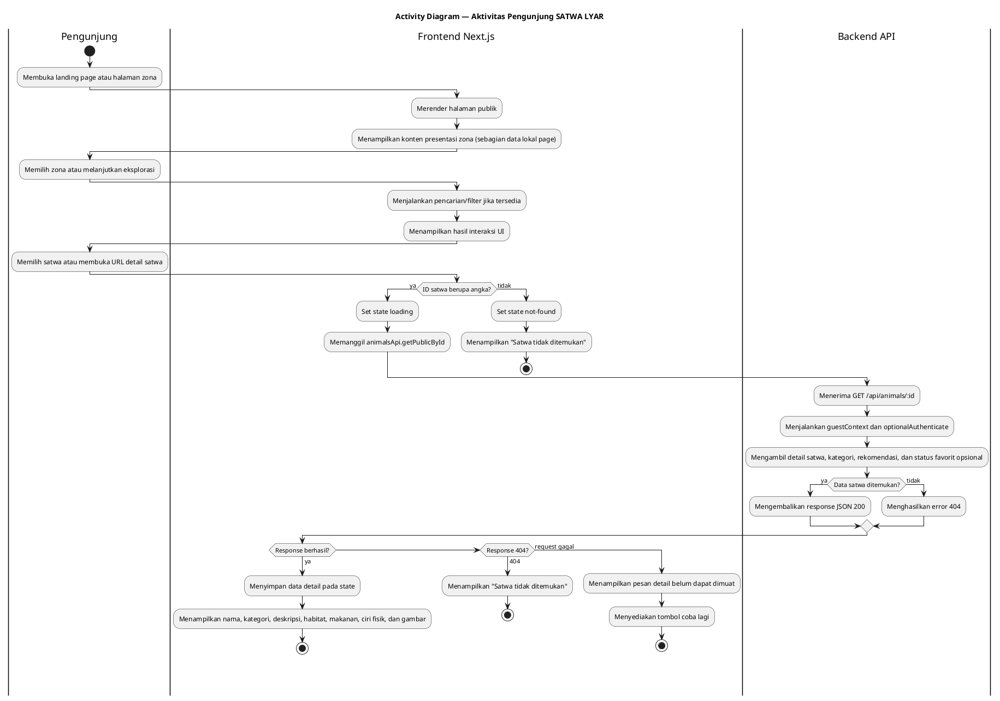
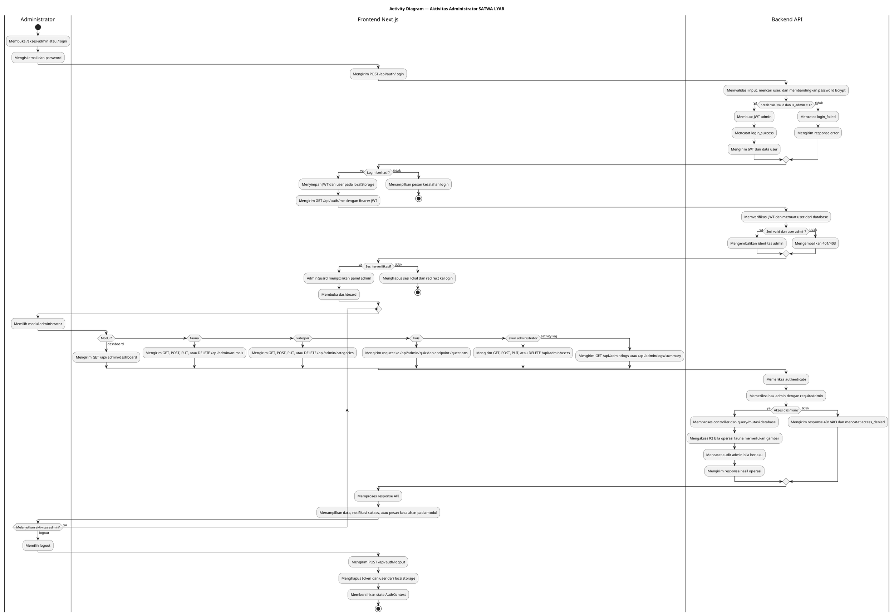
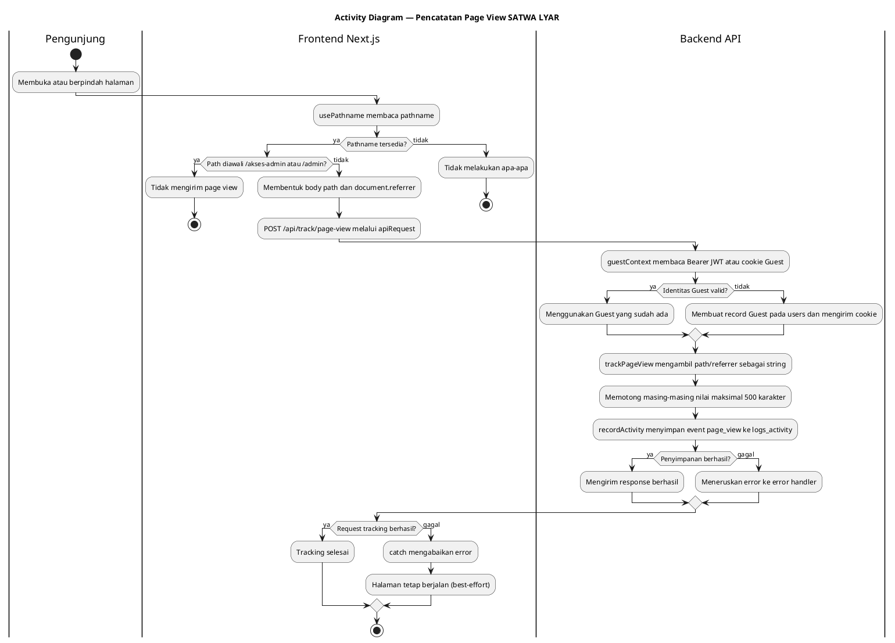

# 04 — Activity Diagram SATWA LYAR

Dokumen ini memuat tiga activity diagram berdasarkan alur aktual frontend Next.js, API client, route/controller backend, middleware, dan database. Data presentasi pada halaman landing/zona dibedakan dari detail satwa yang diambil melalui API.

## 1. Activity Diagram Aktivitas Pengunjung

### Penjelasan

Halaman detail memvalidasi ID agar berupa angka, menampilkan state loading, memanggil `animalsApi.getPublicById`, lalu membedakan kondisi 404 dari error request lain. Backend membaca detail dari MariaDB dan membentuk URL gambar publik dari `image_key` bila tersedia. Pencarian/filter pada landing dan halaman zona merupakan state/interaksi pada halaman frontend; diagram tidak menyatakan seluruhnya sebagai query API.

## 2. Activity Diagram Aktivitas Administrator

### Penjelasan

Sesi frontend memakai JWT yang disimpan pada `localStorage`. Saat aplikasi dimuat, `AuthContext` mengambil token dan memanggil `/api/auth/me`; `AdminGuard` menampilkan spinner selama verifikasi dan mengarahkan ke `/login` jika sesi tidak valid. Setiap route admin backend juga menerapkan `authenticate` dan `requireAdmin`. Modul yang digambarkan sesuai halaman admin aktual: dashboard, animals, categories, quiz, users, dan logs.

## 3. Activity Diagram Pencatatan Page View

### Penjelasan

`PageViewTracker` dipasang pada layout utama dan bereaksi terhadap perubahan pathname. Prefix `/akses-admin` dan `/admin` dikecualikan. Pada halaman publik, request tracking dikirim tanpa mengganggu rendering; error ditangkap dan tidak ditampilkan sebagai kegagalan halaman. `guestContext` membuat atau memulihkan Guest secara otomatis, bukan melalui proses login.

## 4. File sumber pendukung

### Aktivitas pengunjung dan detail satwa

- `apps/web/app/page.tsx`
- `apps/web/app/airtawar/page.tsx`
- `apps/web/app/serangga/page.tsx`
- `apps/web/app/reptils/page.tsx`
- `apps/web/app/burung/page.tsx`
- `apps/web/app/farmhouse/page.tsx`
- `apps/web/app/satwa/[id]/page.tsx`
- `apps/web/lib/api.ts`
- `apps/api/src/modules/animals/animals.public.routes.ts`
- `apps/api/src/modules/animals/animals.public.controller.ts`
- `apps/api/src/middleware/guest-context.middleware.ts`

### Aktivitas administrator

- `apps/web/app/akses-admin/page.tsx`
- `apps/web/app/login/page.tsx`
- `apps/web/context/AuthContext.tsx`
- `apps/web/components/AdminGuard.tsx`
- `apps/web/components/AdminLayout.tsx`
- `apps/web/app/admin/dashboard/*`
- `apps/web/app/admin/animals/page.tsx`
- `apps/web/app/admin/categories/page.tsx`
- `apps/web/app/admin/quiz/page.tsx`
- `apps/web/app/admin/users/page.tsx`
- `apps/web/app/admin/logs/page.tsx`
- `apps/api/src/modules/auth/*`
- `apps/api/src/middleware/auth.middleware.ts`
- `apps/api/src/middleware/role.middleware.ts`
- `apps/api/src/modules/dashboard/*`
- `apps/api/src/modules/animals/*`
- `apps/api/src/modules/categories/*`
- `apps/api/src/modules/quiz/*`
- `apps/api/src/modules/users/*`
- `apps/api/src/modules/logs/*`

### Pencatatan page view dan database

- `apps/web/app/layout.tsx`
- `apps/web/components/PageViewTracker.tsx`
- `apps/web/lib/api.ts`
- `apps/api/src/modules/track/track.routes.ts`
- `apps/api/src/modules/track/track.controller.ts`
- `apps/api/src/middleware/guest-context.middleware.ts`
- `apps/api/src/middleware/activity-logger.middleware.ts`
- `apps/api/src/modules/logs/logs.service.ts`
- `apps/api/src/database/schema.sql`

## 5. Catatan validasi

- Diagram tidak memasukkan favorit, kuis pengguna, atau profil sebagai aktivitas frontend karena tidak ditemukan halaman frontend pengguna yang memanggil endpoint tersebut.
- Detail satwa dibedakan dari halaman zona: detail menggunakan request `GET /api/animals/:id`, sedangkan beberapa halaman zona memiliki konten presentasi lokal.
- Ketiga diagram menggunakan PlantUML dan masing-masing memiliki pasangan `@startuml`/`@enduml`.
- Tidak ada source code aplikasi yang diubah.

## 6. Tabel audit akhir

| Aktivitas yang diperiksa | File dan fungsi sumber | Hasil verifikasi | Perubahan yang dilakukan |
|---|---|---|---|
| Validasi ID detail satwa | `apps/web/app/satwa/[id]/page.tsx` — `loadAnimal` | ID harus cocok dengan `/^\d+$/`; jika tidak, state menjadi `not-found`. | Dipertahankan pada diagram pengunjung. |
| Request detail satwa | `apps/web/lib/api.ts` — `animalsApi.getPublicById`; `apps/api/src/modules/animals/animals.public.routes.ts` — `GET /:id` | Frontend memanggil `GET /api/animals/:id`; route memakai `optionalAuthenticate`. | Dipertahankan dan dijelaskan sebagai alur API detail. |
| Data detail satwa | `animals.public.controller.ts` — `getPublicAnimalById` | Controller mengambil field satwa, kategori, URL gambar, rekomendasi satwa sejenis, dan `is_favorite`. | Status favorit tetap dicantumkan karena terbukti dikembalikan controller. |
| Error detail satwa | `page.tsx` — `catch` pada `loadAnimal`; `animals.public.controller.ts` | HTTP 404 menjadi state `not-found`; error lain menjadi state `error` dengan opsi coba lagi; abort request diabaikan. | Percabangan 404 dan request gagal dipertahankan. |
| Login admin berhasil/gagal | `apps/api/src/modules/auth/auth.controller.ts` — `login` | Kredensial salah dicatat `login_failed`; admin valid dicatat `login_success`; akun non-admin dicatat `access_denied`. | Tetap dicantumkan pada alur login. |
| Penyimpanan dan verifikasi sesi | `apps/web/context/AuthContext.tsx` — `login`, `initAuth`; `apps/web/components/AdminGuard.tsx` | JWT dan user disimpan di `localStorage`; sesi diverifikasi melalui `GET /api/auth/me`; sesi tidak valid dibersihkan dan diarahkan ke login. | Dipertahankan sesuai frontend aktual. |
| Akses modul admin | `apps/api/src/modules/*/*.routes.ts`; `auth.middleware.ts` — `authenticate`; `role.middleware.ts` — `requireAdmin` | Dashboard, fauna, kategori, kuis, users, dan logs menerapkan autentikasi serta pemeriksaan admin pada route. | Diagram diubah menjadi request → validasi → proses → response per modul. |
| Operasi endpoint admin | `apps/web/lib/api.ts`; seluruh halaman `apps/web/app/admin/*` | Endpoint yang digambarkan sesuai client: dashboard, animals, categories, quiz/questions, users, logs. | Endpoint modul ditulis langsung pada cabang aktivitas administrator. |
| Integrasi Cloudflare R2 | `apps/api/src/modules/animals/animals.controller.ts` — create/update/delete image; `apps/api/src/config/r2.ts` | R2 digunakan pada operasi gambar fauna, bukan pada dashboard, kategori, kuis, users, atau logs. | Diagram membatasi R2 pada operasi fauna yang memerlukan gambar. |
| Audit akses admin | `role.middleware.ts` — `requireAdmin`; `auth.controller.ts` — penolakan akun non-admin | Akses ditolak dicatat sebagai `access_denied` sebelum response 403 pada role guard dan saat login akun non-admin. | Dipertahankan pada cabang akses ditolak. |
| PageViewTracker | `apps/web/components/PageViewTracker.tsx` | Membaca pathname; mengabaikan pathname kosong dan prefix `/akses-admin`/`/admin`; mengirim POST tracking untuk halaman lain; error ditangkap. | Pengecualian dan sifat best-effort dipertahankan. |
| Resolusi Guest | `apps/api/src/app.ts` — urutan middleware; `guest-context.middleware.ts` — `guestContext` | `guestContext` berjalan sebelum `activityLogger` dan route; memeriksa Bearer JWT, cookie Guest, atau membuat Guest baru serta cookie. | Urutan dan mekanisme cookie dipertahankan tanpa memodelkan login Guest. |
| Penyimpanan page view | `apps/api/src/modules/track/track.controller.ts` — `trackPageView`; `logs.service.ts` — `recordActivity` | Path/referrer dinormalisasi dan dipotong maksimal 500 karakter, lalu disimpan sebagai event `page_view`; kegagalan diteruskan ke error handler. | Diagram memakai istilah response berhasil tanpa mengandalkan kode status tertentu. |

### Kesimpulan audit

Tidak ditemukan ketidaksesuaian material antara tiga diagram dan source code yang diperiksa. Status favorit pada detail satwa memiliki bukti langsung pada controller. Perubahan utama audit adalah memperjelas request–response setiap modul administrator, membatasi integrasi R2 pada operasi gambar fauna, serta mendokumentasikan status tracking secara generik sebagai response berhasil dan best-effort.
