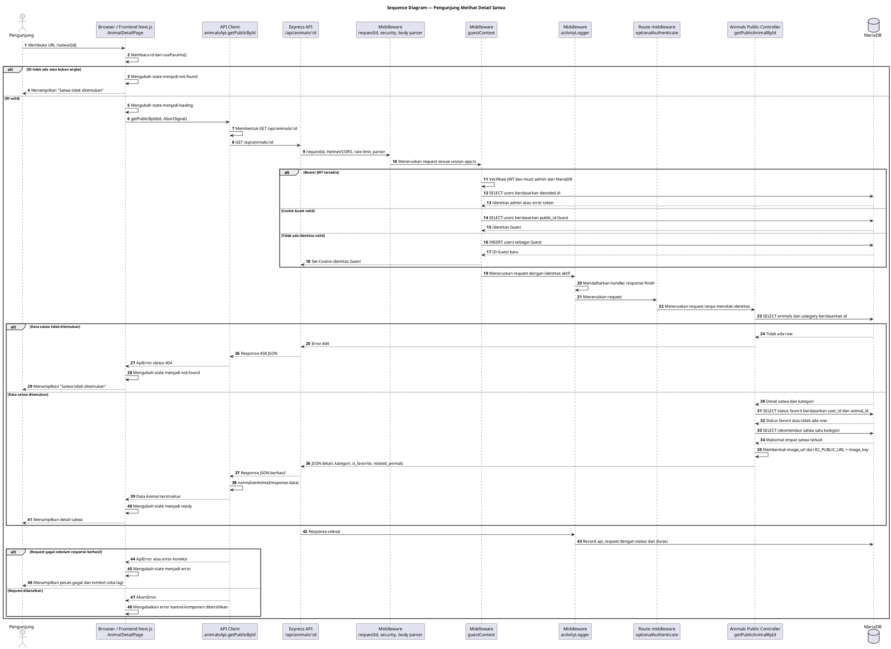
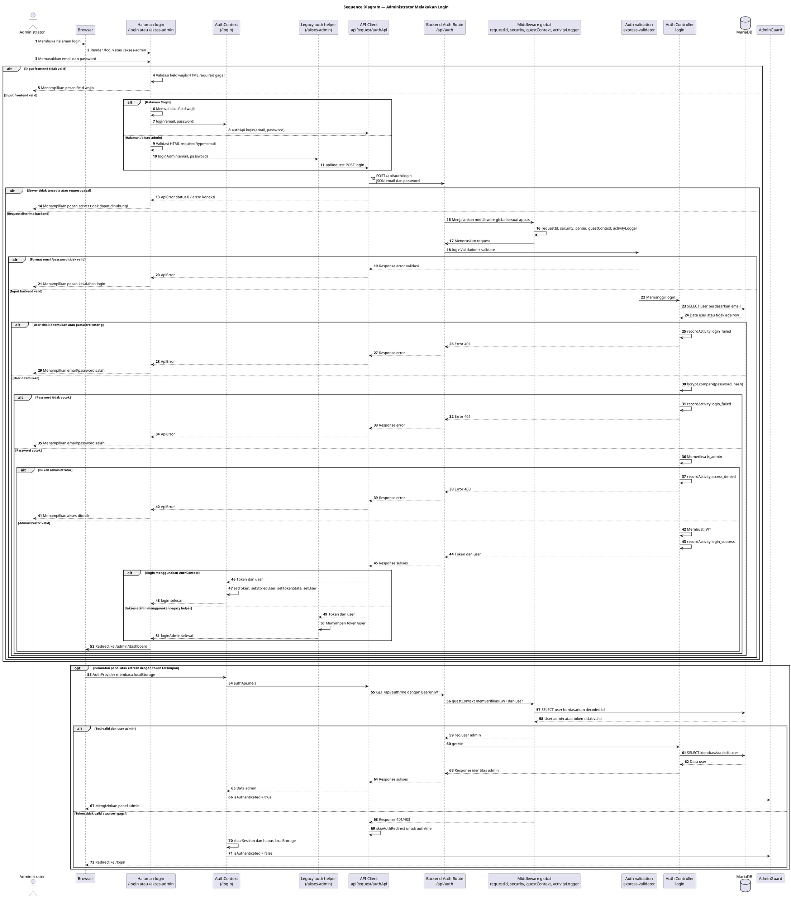

# 05 — Sequence Diagram SATWA LYAR

## Sequence Diagram — Pengunjung Melihat Detail Satwa

Diagram berikut hanya membahas alur yang telah terverifikasi pada halaman `apps/web/app/satwa/[id]/page.tsx` dan endpoint publik detail satwa. Redis tidak dilibatkan karena controller detail menggunakan query MariaDB langsung. Cloudflare R2 juga tidak dipanggil langsung pada alur ini; backend hanya membentuk `image_url` dari `R2_PUBLIC_URL` dan `image_key`.

## Penjelasan tahapan

1. `AnimalDetailPage` membaca parameter `id` dari `useParams`. Regex `/^\d+$/` digunakan sebelum request. ID kosong atau bukan angka langsung menghasilkan state `not-found` tanpa memanggil API.
2. Untuk ID valid, frontend mengatur state `loading`, membuat `AbortController`, lalu memanggil `animalsApi.getPublicById`.
3. API client memanggil `apiRequest` dengan `GET /api/animals/:id`, melakukan URL encoding terhadap ID, dan menggunakan `skipAuthRedirect: true`. Request tidak memerlukan sesi admin.
4. Pada Express, urutan global aktual dimulai dari `requestId`, Helmet/CORS, rate limit, body parser, Morgan, `guestContext`, lalu `activityLogger`. Route animals publik kemudian menjalankan `optionalAuthenticate` sebelum controller.
5. `guestContext` memproses Bearer JWT jika tersedia; jika tidak, ia memulihkan Guest dari cookie atau membuat record Guest baru dan mengirim cookie. Proses ini bukan login Pengunjung.
6. `getPublicAnimalById` melakukan query detail satwa beserta kategori. Jika tidak ada row, controller meneruskan error 404.
7. Jika data tersedia, controller melakukan query status favorit berdasarkan identitas aktif, query maksimal empat rekomendasi pada kategori yang sama, lalu mengembalikan detail satwa, field habitat/makanan/ciri fisik, kategori, `is_favorite`, `related_animals`, dan URL gambar.
8. Frontend menormalisasi data, mengubah state menjadi `ready`, dan merender detail. Error 404 menjadi halaman not-found; error lain menjadi halaman error dengan aksi coba lagi. Abort akibat cleanup `useEffect` diabaikan.
9. `activityLogger` mencatat request API setelah response selesai. Pencatatan ini terpisah dari query bisnis detail satwa.

## File sumber pendukung

| File | Fungsi yang relevan |
|---|---|
| `apps/web/app/satwa/[id]/page.tsx` | `AnimalDetailPage`, validasi ID, state loading/ready/error/not-found, `AbortController`, render detail |
| `apps/web/lib/api.ts` | `apiRequest`, `animalsApi.getPublicById`, `normalizeAnimal`, penanganan `ApiError` |
| `apps/api/src/app.ts` | Urutan middleware global dan mount `/api/animals` |
| `apps/api/src/middleware/request-id.middleware.ts` | Pembuatan/korelasi request ID |
| `apps/api/src/middleware/guest-context.middleware.ts` | Resolusi JWT admin, cookie Guest, atau pembuatan Guest |
| `apps/api/src/middleware/activity-logger.middleware.ts` | Pencatatan `api_request` setelah response selesai |
| `apps/api/src/middleware/auth.middleware.ts` | Implementasi `optionalAuthenticate` yang meneruskan request |
| `apps/api/src/modules/animals/animals.public.routes.ts` | `GET /api/animals/:id` dan pemasangan `optionalAuthenticate` |
| `apps/api/src/modules/animals/animals.public.controller.ts` | `getPublicAnimalById`, query detail/kategori, favorit, rekomendasi, dan pembentukan response |
| `apps/api/src/modules/logs/logs.service.ts` | `recordActivity` yang dipanggil activity logger |
| `apps/api/src/database/schema.sql` | Tabel `users`, `animals`, `categories`, dan `favorites` |

## Batasan dan hasil validasi

- Tidak ada proses login Guest pada sequence ini.
- Tidak ada interaksi Redis karena `getPublicAnimalById` tidak memanggil adapter Redis.
- Tidak ada request langsung ke Cloudflare R2; URL gambar dibentuk dari konfigurasi publik dan `image_key`.
- Status favorit dicantumkan karena controller mengembalikan `is_favorite` dan melakukan query tabel `favorites`.
- Sequence ini tidak menggambarkan use case favorit atau kuis pengguna sebagai aktivitas frontend terpisah.
- Dokumen ini tidak mengubah source code aplikasi.

## Sequence Diagram — Administrator Melakukan Login

Diagram berikut melanjutkan diagram detail satwa dengan alur login Administrator. Source frontend memiliki dua entry page yang masih tersedia: `/login` menggunakan `AuthContext`, sedangkan `/akses-admin` menggunakan helper `apps/web/lib/auth.ts`. Keduanya memanggil endpoint backend yang sama dan menyimpan token/user pada `localStorage`.

### Penjelasan tahapan login

1. Administrator membuka `/login` atau `/akses-admin`. Pada `/login`, validasi tambahan memeriksa email dan password tidak kosong; pada `/akses-admin`, input HTML memiliki `required` dan tipe email.
2. `/login` meneruskan proses ke `AuthContext.login`, sedangkan `/akses-admin` memakai `loginAdmin` dari `lib/auth.ts`. Keduanya menggunakan API client untuk `POST /api/auth/login`.
3. Backend menjalankan middleware global lebih dahulu. Route login kemudian menjalankan `loginValidation` dan `validate` sebelum `auth.controller.login`.
4. Controller mencari user berdasarkan email dan membandingkan password menggunakan `bcrypt.compare`. Kredensial salah dicatat sebagai `login_failed` dan menghasilkan error 401.
5. Jika password cocok tetapi `is_admin` bukan 1, controller mencatat `access_denied` dan mengembalikan error 403.
6. Jika akun admin valid, controller membuat JWT, mencatat `login_success`, lalu mengembalikan token dan informasi user.
7. AuthContext memakai `setToken`, `setStoredUser`, dan state React. Helper lama memakai `saveAdminSession`. Keduanya menyimpan sesi pada `localStorage`.
8. `GET /api/auth/me` bukan request yang selalu dilakukan tepat setelah response login. Request ini dilakukan oleh `AuthContext` saat provider dimuat atau saat panel di-refresh jika token sudah tersimpan. `AdminGuard` mengizinkan panel hanya jika sesi terverifikasi sebagai admin.

### File sumber pendukung

| File | Fungsi yang relevan |
|---|---|
| `apps/web/app/login/page.tsx` | Form login berbasis `AuthContext`, validasi field, error, dan redirect |
| `apps/web/app/akses-admin/page.tsx` | Form login alternatif, validasi HTML, pemanggilan `loginAdmin`, dan redirect |
| `apps/web/context/AuthContext.tsx` | `login`, `initAuth`, `authApi.me`, penyimpanan state sesi, dan `clearSession` |
| `apps/web/lib/auth.ts` | `loginAdmin`, `saveAdminSession`, validasi `is_admin`, dan penyimpanan legacy session |
| `apps/web/lib/api.ts` | `apiRequest`, `authApi.login`, `authApi.me`, storage helper, dan `ApiError` |
| `apps/web/components/AdminGuard.tsx` | Menahan panel saat loading dan redirect jika sesi tidak terautentikasi |
| `apps/api/src/app.ts` | Urutan middleware global dan mount `/api/auth` |
| `apps/api/src/modules/auth/auth.routes.ts` | `POST /login`, middleware `loginValidation`/`validate`, `GET /me` dengan `authenticate` |
| `apps/api/src/modules/auth/auth.validation.ts` | Validasi email, password wajib, dan panjang minimal password login |
| `apps/api/src/modules/auth/auth.controller.ts` | `login`, `getMe`, bcrypt, pemeriksaan `is_admin`, JWT, dan audit login |
| `apps/api/src/middleware/guest-context.middleware.ts` | Verifikasi Bearer JWT atau resolusi Guest sebelum route |
| `apps/api/src/middleware/auth.middleware.ts` | `authenticate` untuk endpoint `/api/auth/me` |
| `apps/api/src/middleware/error.middleware.ts` | Konversi error controller/validasi menjadi response error |
| `apps/api/src/database/schema.sql` | Struktur `users` dan flag `is_admin` |

### Batasan validasi

- `/akses-admin` dan `/login` sama-sama tersedia pada source, tetapi memiliki dua jalur helper frontend yang berbeda.
- `GET /api/auth/me` adalah verifikasi sesi saat `AuthProvider` dimuat dengan token tersimpan; diagram tidak menyatakan bahwa endpoint tersebut selalu dipanggil langsung setelah setiap login baru.
- Tidak ada proses registrasi atau login Guest pada alur ini.
- Dokumen ini hanya menambahkan dokumentasi dan tidak mengubah source code aplikasi.

## Sequence Diagram — Administrator Mengelola Data Satwa (CRUD Fauna)

Diagram berikut memodelkan alur yang digunakan oleh halaman `admin/animals`. Validasi pentingnya adalah daftar satwa pada halaman tersebut memanggil `GET /api/animals` melalui endpoint publik dengan `optionalAuthenticate`, sedangkan detail admin dan operasi mutasi menggunakan route terlindungi `/api/admin/animals` dengan `authenticate` dan `requireAdmin`.

```plantuml
@startuml
title Sequence Diagram — Administrator Mengelola Data Satwa (CRUD Fauna)
autonumber

actor "Administrator" as Admin
participant "Browser / Frontend Next.js\nadmin/animals/page.tsx" as Web
participant "API Client\nanimalsApi" as Client
participant "Route publik\nGET /api/animals" as PublicRoute
participant "Route admin\n/api/admin/animals" as AdminRoute
participant "Middleware global\nrequestId, security, parser, guestContext, activityLogger" as GlobalMW
participant "Middleware admin\nauthenticate + requireAdmin" as AdminMW
participant "Multer + express-validator" as Validation
participant "Animals Controller\ngetAllAnimals, getAnimalById, createAnimal, updateAnimal, deleteAnimal" as Controller
database "MariaDB" as DB
participant "Cloudflare R2" as R2
participant "Audit log\nrecordAdminAction" as Audit
participant "Upstash Redis\nbumpCacheVersion (opsional)" as Redis

Admin -> Web: Membuka /admin/animals
Web -> Web: AdminLayout/AdminGuard memeriksa sesi yang tersedia
Web -> Client: animalsApi.list(filter, signal)
Client -> PublicRoute: GET /api/animals?page,limit,search,category_id,sort
Client -> GlobalMW: Menjalankan middleware global
GlobalMW -> GlobalMW: requestId, security, parser, guestContext, activityLogger
GlobalMW -> PublicRoute: Meneruskan request ke route publik
PublicRoute -> PublicRoute: optionalAuthenticate
PublicRoute -> Controller: getAllAnimals
Controller -> DB: COUNT dan SELECT animals JOIN categories
DB --> Controller: Daftar fauna dan total data
Controller -> Controller: Membentuk image_url dari R2_PUBLIC_URL dan image_key
Controller --> PublicRoute: Response daftar dan pagination
PublicRoute --> Client: Response berhasil atau error
Client --> Web: Data daftar atau ApiError
alt Daftar berhasil
    Web --> Admin: Menampilkan tabel, filter, dan pagination
else Request daftar gagal
    Web --> Admin: Menampilkan error dan opsi memuat ulang
end

== Tambah fauna ==
Admin -> Web: Memilih tambah fauna
Web -> Web: Membuka AnimalForm
Admin -> Web: Mengisi data fauna dan memilih gambar opsional
Web -> Web: Memvalidasi field, ukuran/tipe file, lalu membentuk FormData
Web -> Client: animalsApi.create(formData)
Client -> AdminRoute: POST /api/admin/animals multipart/form-data
Client -> GlobalMW: Menjalankan middleware global
GlobalMW -> GlobalMW: requestId, security, parser, guestContext, activityLogger
GlobalMW -> AdminRoute: Meneruskan request ke route admin
AdminRoute -> AdminMW: Menjalankan middleware route admin
AdminMW -> AdminMW: authenticate lalu requireAdmin
alt Sesi atau hak akses tidak valid
    AdminMW --> Client: Response 401/403
    Client --> Web: ApiError
    Web --> Admin: Menampilkan kegagalan tambah fauna
else Administrator diizinkan
    AdminMW -> Validation: multer, createAnimalValidation, validate
    alt File atau data tidak valid
        Validation --> Client: Response error validasi
        Client --> Web: ApiError
        Web --> Admin: Menampilkan error pada form
    else Data valid
        Validation -> Controller: createAnimal
        Controller -> DB: SELECT kategori berdasarkan category_id
        alt Kategori tidak ditemukan
            Controller --> AdminRoute: Error 404
            AdminRoute --> Client: Response error
            Client --> Web: ApiError
            Web --> Admin: Menampilkan kategori tidak ditemukan
        else Kategori tersedia
            opt Gambar dipilih
                Controller -> R2: PutObject fauna/{uuid}.{ext}
                R2 --> Controller: Upload berhasil dan image_key
            end
            Controller -> DB: INSERT INTO animals dengan image_key
            DB --> Controller: insertId
            Controller -> DB: SELECT fauna baru dan kategori
            DB --> Controller: Data fauna baru
            Controller -> Audit: recordAdminAction CREATE_ANIMAL
            opt Gambar berhasil diunggah
                Controller -> Audit: recordAdminAction UPLOAD_ANIMAL_IMAGE
            end
            Controller -> Redis: bumpCacheVersion
            Redis --> Controller: Selesai atau no-op jika Redis tidak dikonfigurasi
            Controller --> AdminRoute: Response 201 dan data fauna
            AdminRoute --> Client: Response berhasil
            Client --> Web: Data sukses
            Web -> Web: Menutup form dan memuat ulang daftar
            Web --> Admin: Menampilkan notifikasi berhasil
        end
    end
end

== Edit fauna ==
Admin -> Web: Memilih edit fauna
Web -> Client: animalsApi.getById(id)
Client -> AdminRoute: GET /api/admin/animals/:id
Client -> GlobalMW: Menjalankan middleware global
GlobalMW -> GlobalMW: requestId, security, parser, guestContext, activityLogger
GlobalMW -> AdminRoute: Meneruskan request ke route admin
AdminRoute -> AdminMW: authenticate dan requireAdmin
AdminMW -> Controller: getAnimalById jika akses diizinkan
Controller -> DB: SELECT animals JOIN categories berdasarkan id
alt Fauna tidak ditemukan atau akses gagal
    Controller --> Client: Response error 404 atau 401/403
    Client --> Web: ApiError
    Web --> Admin: Menampilkan kegagalan memuat data edit
else Data edit tersedia
    DB --> Controller: Data fauna lengkap
    Controller --> AdminRoute: Detail fauna dan image_url
    AdminRoute --> Client: Response berhasil
    Client --> Web: Data untuk AnimalForm
    Web --> Admin: Menampilkan form edit
    Admin -> Web: Mengubah data atau memilih gambar baru
    Web -> Web: Memvalidasi dan membentuk FormData
    Web -> Client: animalsApi.update(id, formData)
    Client -> AdminRoute: PUT /api/admin/animals/:id multipart/form-data
    Client -> GlobalMW: Menjalankan middleware global
    GlobalMW -> GlobalMW: requestId, security, parser, guestContext, activityLogger
    GlobalMW -> AdminRoute: Meneruskan request ke route admin
    AdminRoute -> AdminMW: authenticate dan requireAdmin
    alt Sesi atau hak akses tidak valid
        AdminMW --> Client: Response 401/403
        Client --> Web: ApiError
        Web --> Admin: Menampilkan kegagalan pembaruan
    else Administrator diizinkan
        AdminMW -> Validation: multer, updateAnimalValidation, validate
        alt Data atau file tidak valid
            Validation --> Client: Response error validasi
            Client --> Web: ApiError
            Web --> Admin: Menampilkan error pada form
        else Data valid
            Validation -> Controller: updateAnimal
            Controller -> DB: SELECT animals lama berdasarkan id
            alt Fauna tidak ditemukan
                Controller --> AdminRoute: Error 404
                AdminRoute --> Client: Response error
                Client --> Web: ApiError
                Web --> Admin: Menampilkan fauna tidak ditemukan
            else Fauna tersedia
                alt Gambar baru dipilih
                    Controller -> R2: DeleteObject gambar lama jika ada
                    R2 --> Controller: Penghapusan lama selesai
                    Controller -> R2: PutObject gambar baru
                    R2 --> Controller: Upload baru selesai
                else Tidak ada gambar baru
                    Controller -> Controller: Mempertahankan image_key lama
                end
                Controller -> DB: UPDATE animals dan updated_at
                Controller -> DB: SELECT fauna hasil pembaruan
                DB --> Controller: Data fauna terbaru
                Controller -> Audit: recordAdminAction UPDATE_ANIMAL
                Controller -> Redis: bumpCacheVersion
                Redis --> Controller: Selesai atau no-op
                Controller --> AdminRoute: Response 200 dan data fauna
                AdminRoute --> Client: Response berhasil
                Client --> Web: Data sukses
                Web -> Web: Menutup form dan memuat ulang daftar
                Web --> Admin: Menampilkan notifikasi berhasil
            end
        end
    end
end

== Hapus fauna ==
Admin -> Web: Memilih hapus dan mengonfirmasi dialog
Web -> Client: animalsApi.remove(id)
Client -> AdminRoute: DELETE /api/admin/animals/:id
Client -> GlobalMW: Menjalankan middleware global
GlobalMW -> GlobalMW: requestId, security, parser, guestContext, activityLogger
GlobalMW -> AdminRoute: Meneruskan request ke route admin
AdminRoute -> AdminMW: authenticate dan requireAdmin
alt Sesi atau hak akses tidak valid
    AdminMW --> Client: Response 401/403
    Client --> Web: ApiError
    Web --> Admin: Menampilkan kegagalan penghapusan
else Administrator diizinkan
    AdminMW -> Controller: deleteAnimal
    Controller -> DB: SELECT animals berdasarkan id
    alt Fauna tidak ditemukan
        Controller --> AdminRoute: Error 404
        AdminRoute --> Client: Response error
        Client --> Web: ApiError
        Web --> Admin: Menampilkan fauna tidak ditemukan
    else Fauna tersedia
        opt Fauna memiliki image_key
            Controller -> R2: DeleteObject gambar fauna
            R2 --> Controller: Penghapusan gambar selesai
        end
        Controller -> DB: DELETE FROM animals WHERE id = ?
        Controller -> Audit: recordAdminAction DELETE_ANIMAL
        Controller -> Redis: bumpCacheVersion
        Redis --> Controller: Selesai atau no-op
        Controller --> AdminRoute: Response 200
        AdminRoute --> Client: Response berhasil
        Client --> Web: Sukses
        Web -> Web: Menutup dialog dan memuat ulang daftar
        Web --> Admin: Menampilkan notifikasi berhasil
    end
end

note over Web,Client
Penghapusan gambar yang dipakai halaman admin dilakukan melalui update dengan
field remove_image=1 bila form mengirimkannya. Endpoint DELETE /api/admin/animals/:id/image
tersedia di backend, tetapi tidak dipanggil oleh alur halaman yang diperiksa.
end note
@enduml
```

### Penjelasan tahapan

1. Saat halaman dibuka, `admin/animals/page.tsx` memuat daftar menggunakan `animalsApi.list`. Implementasi client menggunakan `GET /api/animals`, sehingga permintaan daftar melewati route publik dan `optionalAuthenticate`; perlindungan administrator berasal dari `AdminLayout`/`AdminGuard`, bukan `requireAdmin` pada endpoint daftar tersebut.
2. Tambah fauna menggunakan `AnimalForm`, validasi frontend, `FormData`, dan `POST /api/admin/animals`. Backend menjalankan `authenticate`, `requireAdmin`, `multer`, validasi `express-validator`, pemeriksaan kategori, lalu `createAnimal`.
3. Jika file gambar disertakan, `createAnimal` membuat `image_key` baru dan mengunggah buffer ke Cloudflare R2 melalui `PutObjectCommand`. Record fauna kemudian disimpan pada tabel `animals`, audit dicatat, dan versi cache dinaikkan jika Redis tersedia.
4. Edit diawali `animalsApi.getById` ke `GET /api/admin/animals/:id`. Setelah data diterima, form mengirim `PUT /api/admin/animals/:id`. Gambar lama hanya dihapus dari R2 dan diganti jika file baru dikirim; tanpa file baru, `image_key` dipertahankan.
5. Pada implementasi `AnimalForm`, penghapusan gambar dikirim sebagai `remove_image=1` dalam FormData. Controller yang diperiksa tidak menggunakan field tersebut untuk mengosongkan `image_key`; endpoint khusus `DELETE /api/admin/animals/:id/image` memang tersedia, tetapi tidak dipanggil oleh halaman admin yang diperiksa. Oleh karena itu diagram tidak menyatakan bahwa tombol penghapusan gambar pada form berhasil menghapus gambar melalui alur update.
6. Hapus fauna menggunakan dialog konfirmasi dan `DELETE /api/admin/animals/:id`. Controller menghapus objek R2 jika ada, menghapus row `animals`, mencatat audit, dan menginvalidasi versi cache.
7. Operasi gambar di R2 dan perubahan metadata di MariaDB bukan satu transaksi atomik yang dibuktikan oleh source code. Pada penggantian gambar, controller menghapus gambar lama, mengunggah gambar baru, kemudian memperbarui `image_key` di MariaDB. Jika salah satu tahap gagal, file pada R2 dan metadata MariaDB dapat menjadi tidak sinkron; tidak ditemukan rollback atau mekanisme kompensasi otomatis.
8. Error non-2xx diubah API client menjadi `ApiError`; halaman menampilkan error form, toast, atau error list sesuai operasi. Kegagalan upload R2 atau query database diteruskan melalui error handler backend dan tidak menghasilkan response sukses.

### File sumber yang diperiksa

| File | Fungsi atau bukti yang relevan |
|---|---|
| `apps/web/app/admin/animals/page.tsx` | `loadAnimals`, `handleSubmit`, `handleEdit`, `handleDelete`, filter, pagination, dan pemanggilan API |
| `apps/web/components/AnimalForm.tsx` | Validasi field/file, crop gambar, `FormData`, `remove_image`, dan submit tambah/edit |
| `apps/web/components/AnimalTable.tsx` | Aksi edit dan hapus dari tabel fauna |
| `apps/web/components/DeleteAnimalDialog.tsx` | Konfirmasi penghapusan fauna |
| `apps/web/lib/api.ts` | `animalsApi.list`, `getById`, `create`, `update`, `remove`, dan `removeImage` |
| `apps/web/components/AdminGuard.tsx` | Perlindungan UI panel admin dan verifikasi sesi |
| `apps/api/src/app.ts` | Urutan middleware global serta mount route `/api/animals` dan `/api/admin/animals` |
| `apps/api/src/modules/animals/animals.routes.ts` | Route admin, `multer`, `authenticate`, `requireAdmin`, dan validator per method |
| `apps/api/src/modules/animals/animals.controller.ts` | `getAllAnimals`, `getAnimalById`, `createAnimal`, `updateAnimal`, `deleteAnimal`, `deleteAnimalImage` |
| `apps/api/src/modules/animals/animals.validation.ts` | `createAnimalValidation`, `updateAnimalValidation`, dan batas field |
| `apps/api/src/middleware/auth.middleware.ts` | `authenticate` dan `optionalAuthenticate` |
| `apps/api/src/middleware/role.middleware.ts` | `requireAdmin` serta pencatatan `access_denied` |
| `apps/api/src/middleware/activity-logger.middleware.ts` | Pencatatan `api_request` setelah response selesai |
| `apps/api/src/config/r2.ts` | Client, bucket, dan URL publik Cloudflare R2 |
| `apps/api/src/config/redis.ts` | `bumpCacheVersion` yang dipanggil setelah mutasi fauna |
| `apps/api/src/modules/logs/logs.service.ts` | `recordAdminAction` untuk audit CRUD dan gambar |
| `apps/api/src/database/schema.sql` | Tabel `animals`, relasi `category_id`, dan kolom `image_key` |

### Batasan dan hasil validasi

- Daftar pada halaman admin memakai endpoint `GET /api/animals` berdasarkan implementasi `animalsApi.list`; diagram tidak mengubahnya menjadi endpoint admin.
- `GET /api/admin/animals/:id`, POST, PUT, DELETE, dan endpoint delete-image berada di route admin yang menerapkan `authenticate` dan `requireAdmin`.
- Cloudflare R2 hanya digambarkan pada upload, penggantian, dan penghapusan objek gambar yang dipanggil controller. R2 tidak digunakan untuk query metadata fauna.
- `removeImage` tersedia pada API client dan route backend, tetapi pemanggilannya dari halaman admin yang diperiksa belum terbukti; form memakai `remove_image=1`, sementara controller update yang diperiksa tidak memproses field tersebut untuk mengosongkan gambar. Bagian ini ditandai sebagai batasan, bukan keberhasilan fitur.
- `bumpCacheVersion` bersifat no-op apabila konfigurasi Redis tidak tersedia; diagram menandainya sebagai integrasi opsional sesuai implementasi.
- Operasi Cloudflare R2 dan MariaDB tidak digambarkan sebagai transaksi atomik. Source code yang diperiksa tidak menunjukkan rollback atau mekanisme kompensasi jika penghapusan/upload gambar atau pembaruan metadata gagal di tengah proses; risiko ketidaksinkronan tersebut perlu diperhitungkan dalam evaluasi keandalan.
- Status HTTP sukses pada endpoint mutasi mengikuti controller (POST 201, PUT/DELETE 200); kegagalan validasi, otorisasi, resource, R2, atau database diteruskan sebagai error dan ditangani frontend.
- Diagram ini hanya mendokumentasikan interaksi yang dipanggil dari halaman admin fauna; kemampuan backend yang tidak memiliki pemanggilan UI tidak diperlakukan sebagai aktivitas frontend tambahan.
