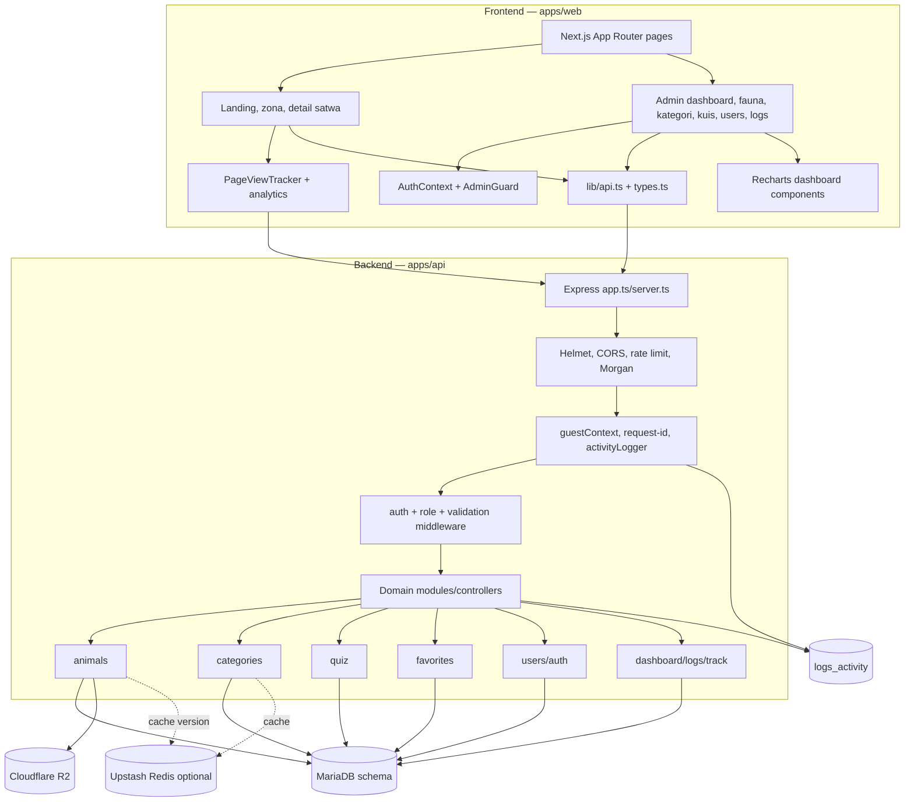

# 06 — Component Diagram SATWA LYAR

Komponen frontend pengguna untuk favorit/kuis pengguna tidak tampak sebagai halaman khusus pada source yang diperiksa, meskipun komponen backend-nya ada. Diagram mempertahankan komponen backend tersebut karena memang terdaftar pada route/module aktual.
