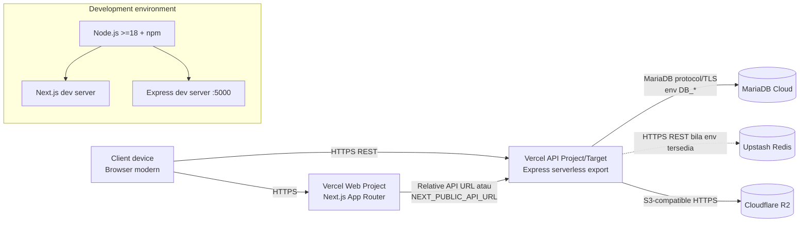

# 07 — Deployment Diagram SATWA LYAR

## Node dan protokol

| Node | Peran | Komunikasi |
|---|---|---|
| Browser | Menjalankan UI dan Fetch | HTTPS ke web/API, cookie, Bearer JWT |
| Vercel Web | Menyajikan Next.js | HTTP internal/relative atau URL API |
| Vercel API | Menjalankan Express export | REST JSON/multipart |
| MariaDB Cloud | Database transaksional | Driver `mariadb`, konfigurasi env |
| Upstash Redis | Cache opsional | REST client |
| Cloudflare R2 | Object storage gambar | AWS S3-compatible API |

Port 5000 teridentifikasi untuk server API lokal. Port production, URL resmi, TLS termination, dan nama project Vercel tidak dapat dipastikan dari source.
