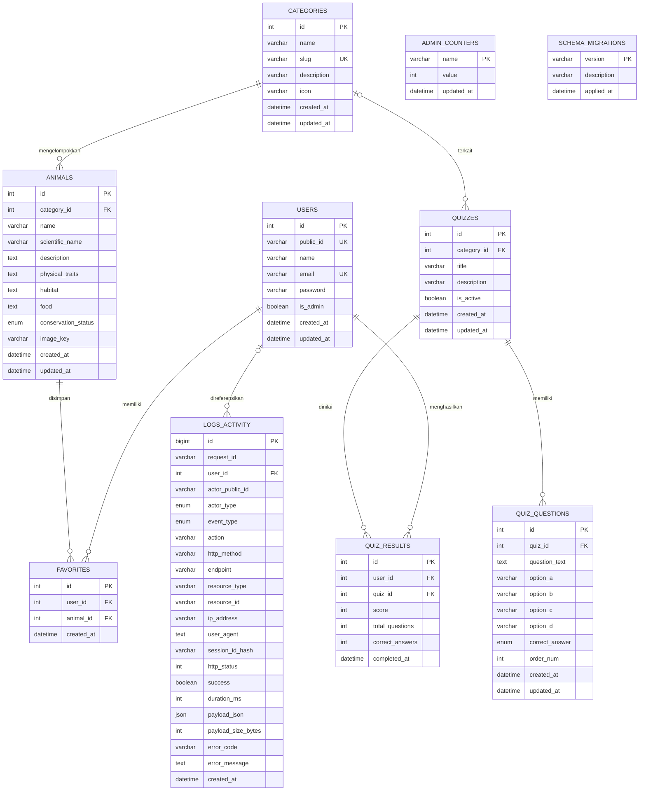

# 08 — Entity Relationship Diagram SATWA LYAR

ERD berikut dibuat dari `apps/api/src/database/schema.sql`, termasuk tabel migrasi logis `schema_migrations` yang dibuat oleh migration runner.

## Relasi dan constraint utama

| Relasi | Constraint/policy |
|---|---|
| `animals.category_id → categories.id` | `ON DELETE RESTRICT`, update cascade |
| `favorites.user_id → users.id` | `ON DELETE CASCADE` |
| `favorites.animal_id → animals.id` | `ON DELETE CASCADE`; pasangan user/animal unik |
| `quizzes.category_id → categories.id` | Nullable, `ON DELETE SET NULL` |
| `quiz_questions.quiz_id → quizzes.id` | `ON DELETE CASCADE` |
| `quiz_results.user_id → users.id` | `ON DELETE CASCADE` |
| `quiz_results.quiz_id → quizzes.id` | `ON DELETE CASCADE` |
| `logs_activity.user_id → users.id` | Nullable, `ON DELETE SET NULL` |

`admin_counters` dan `schema_migrations` adalah tabel pendukung dan tidak memiliki foreign key ke entitas domain. `users.is_admin` membedakan guest (`0`) dan admin (`1`); CHECK constraint schema mengharuskan field identitas admin terisi dan field tersebut NULL untuk guest.
