# 09 — Sequence Diagram Pengelolaan Kategori Satwa

Dokumen ini menggambarkan alur aktual administrator dalam melihat, menambah, mengubah, dan menghapus kategori satwa. Dasar utama diagram adalah halaman `apps/web/app/admin/categories/page.tsx`, API client `categoriesApi`, serta route dan controller kategori pada backend.

## Sequence Diagram — Administrator Mengelola Kategori Satwa

Seluruh endpoint kategori administrator berada di bawah `/api/admin/categories` dan dilindungi oleh `authenticate` serta `requireAdmin`. Middleware global dijalankan lebih dahulu sebelum request diteruskan ke route admin.

```plantuml
@startuml
title Sequence Diagram — Administrator Mengelola Kategori Satwa
autonumber

actor "Administrator" as Admin
participant "Browser / Frontend Next.js\nadmin/categories/page.tsx" as Web
participant "API Client\ncategoriesApi" as Client
participant "Middleware global\nrequestId, security, parser, guestContext, activityLogger" as GlobalMW
participant "Route admin\n/api/admin/categories" as Route
participant "Middleware admin\nauthenticate + requireAdmin" as AdminMW
participant "Validation\nexpress-validator" as Validation
participant "Categories Controller\ngetAllCategories, createCategory, updateCategory, deleteCategory" as Controller
database "MariaDB" as DB
participant "Audit log\nrecordAdminAction" as Audit
participant "Upstash Redis\nbumpCacheVersion (opsional)" as Redis

== Memuat daftar kategori ==
Admin -> Web: Membuka /admin/categories
Web -> Web: AdminLayout/AdminGuard memeriksa sesi pada UI
Web -> Client: categoriesApi.getAll()
Client -> GlobalMW: GET /api/admin/categories
GlobalMW -> GlobalMW: requestId, security, parser, guestContext, activityLogger
GlobalMW -> Route: Meneruskan request ke route admin
Route -> AdminMW: authenticate lalu requireAdmin
alt Sesi tidak valid atau bukan administrator
    AdminMW --> Client: Response 401/403
    Client --> Web: ApiError
    Web --> Admin: Menampilkan error dan opsi coba lagi
else Akses administrator diizinkan
    AdminMW -> Controller: getAllCategories
    Controller -> DB: SELECT categories LEFT JOIN animals\nCOUNT fauna, GROUP BY kategori
    DB --> Controller: Daftar kategori dan total_animals
    Controller --> Route: Response 200 berisi data kategori
    Route --> Client: Response berhasil
    Client --> Web: Category[]
    Web --> Admin: Menampilkan tabel kategori
end

== Menambah kategori ==
Admin -> Web: Memilih Tambah Kategori
Web -> Web: Membuka form kategori inline
Admin -> Web: Mengisi nama, slug, deskripsi, dan ikon opsional
Web -> Web: Validasi HTML required, maxLength, dan pattern slug
alt Validasi frontend gagal
    Web --> Admin: Browser menampilkan pesan validasi
else Input frontend dapat dikirim
    Web -> Client: categoriesApi.create(payload)
    Client -> GlobalMW: POST /api/admin/categories dengan JSON
    GlobalMW -> GlobalMW: requestId, security, parser, guestContext, activityLogger
    GlobalMW -> Route: Meneruskan request ke route admin
    Route -> AdminMW: authenticate lalu requireAdmin
    alt Sesi tidak valid atau bukan administrator
        AdminMW --> Client: Response 401/403
        Client --> Web: ApiError
        Web --> Admin: Menampilkan kegagalan penyimpanan
    else Akses administrator diizinkan
        AdminMW -> Validation: createCategoryValidation lalu validate
        alt Validasi backend gagal
            Validation --> Route: Response 422 Validasi gagal
            Route --> Client: Response 422
            Client --> Web: ApiError
            Web --> Admin: Menampilkan pesan kesalahan
        else Input valid
            Validation -> Controller: createCategory
            Controller -> DB: SELECT id FROM categories WHERE slug = ?
            alt Slug sudah digunakan
                Controller --> Route: Error 409
                Route --> Client: Response konflik slug
                Client --> Web: ApiError
                Web --> Admin: Menampilkan slug sudah digunakan
            else Slug tersedia
                Controller -> DB: INSERT INTO categories
                DB --> Controller: insertId
                Controller -> DB: SELECT kategori baru berdasarkan id
                DB --> Controller: Data kategori baru
                Controller -> Audit: recordAdminAction CREATE_CATEGORY
                Controller -> Redis: bumpCacheVersion
                Redis --> Controller: Selesai atau no-op jika Redis tidak dikonfigurasi
                Controller --> Route: Response 201 dan data kategori
                Route --> Client: Response berhasil
                Client --> Web: Pesan sukses
                Web -> Web: Menutup form dan memuat ulang daftar
                Web --> Admin: Menampilkan kategori baru
            end
        end
    end
end

== Mengubah kategori ==
Admin -> Web: Memilih tombol edit pada baris kategori
Web -> Web: Mengisi form dari data kategori yang sudah dimuat
Admin -> Web: Mengubah nama, slug, deskripsi, atau ikon
Web -> Web: Validasi HTML maxLength dan pattern slug
alt Validasi frontend gagal
    Web --> Admin: Browser menampilkan pesan validasi
else Input frontend dapat dikirim
    Web -> Client: categoriesApi.update(id, payload)
    Client -> GlobalMW: PUT /api/admin/categories/:id dengan JSON
    GlobalMW -> GlobalMW: requestId, security, parser, guestContext, activityLogger
    GlobalMW -> Route: Meneruskan request ke route admin
    Route -> AdminMW: authenticate lalu requireAdmin
    alt Sesi tidak valid atau bukan administrator
        AdminMW --> Client: Response 401/403
        Client --> Web: ApiError
        Web --> Admin: Menampilkan kegagalan pembaruan
    else Akses administrator diizinkan
        AdminMW -> Validation: updateCategoryValidation lalu validate
        alt Validasi backend gagal
            Validation --> Route: Response 422 Validasi gagal
            Route --> Client: Response 422
            Client --> Web: ApiError
            Web --> Admin: Menampilkan pesan kesalahan
        else Input valid
            Validation -> Controller: updateCategory
            Controller -> DB: SELECT id FROM categories WHERE id = ?
            alt Kategori tidak ditemukan
                Controller --> Route: Error 404
                Route --> Client: Response not found
                Client --> Web: ApiError
                Web --> Admin: Menampilkan kategori tidak ditemukan
            else Kategori tersedia
                alt Slug dikirim
                    Controller -> DB: SELECT id FROM categories\nWHERE slug = ? AND id != ?
                    alt Slug konflik
                        Controller --> Route: Error 409
                        Route --> Client: Response konflik slug
                        Client --> Web: ApiError
                        Web --> Admin: Menampilkan slug sudah digunakan
                    else Slug tidak konflik
                        Controller -> DB: UPDATE categories dan updated_at
                        Controller -> DB: SELECT kategori hasil pembaruan
                        DB --> Controller: Data kategori terbaru
                        Controller -> Audit: recordAdminAction UPDATE_CATEGORY
                        Controller -> Redis: bumpCacheVersion
                        Redis --> Controller: Selesai atau no-op jika Redis tidak dikonfigurasi
                        Controller --> Route: Response 200 dan data kategori
                        Route --> Client: Response berhasil
                        Client --> Web: Pesan sukses
                        Web -> Web: Menutup form dan memuat ulang daftar
                        Web --> Admin: Menampilkan perubahan kategori
                    end
                else Slug tidak dikirim
                    Controller -> Controller: Melewati pemeriksaan slug duplikat
                    Controller -> DB: UPDATE categories dan updated_at
                    Controller -> DB: SELECT kategori hasil pembaruan
                    DB --> Controller: Data kategori terbaru
                    Controller -> Audit: recordAdminAction UPDATE_CATEGORY
                    Controller -> Redis: bumpCacheVersion
                    Redis --> Controller: Selesai atau no-op jika Redis tidak dikonfigurasi
                    Controller --> Route: Response 200 dan data kategori
                    Route --> Client: Response berhasil
                    Client --> Web: Pesan sukses
                    Web -> Web: Menutup form dan memuat ulang daftar
                    Web --> Admin: Menampilkan perubahan kategori
                end
            end
        end
    end
end

== Menghapus kategori ==
Admin -> Web: Memilih hapus dan menyetujui window.confirm
Web -> Client: categoriesApi.remove(id)
Client -> GlobalMW: DELETE /api/admin/categories/:id
GlobalMW -> GlobalMW: requestId, security, parser, guestContext, activityLogger
GlobalMW -> Route: Meneruskan request ke route admin
Route -> AdminMW: authenticate lalu requireAdmin
alt Sesi tidak valid atau bukan administrator
    AdminMW --> Client: Response 401/403
    Client --> Web: ApiError
    Web --> Admin: Menampilkan kegagalan penghapusan
else Akses administrator diizinkan
    AdminMW -> Controller: deleteCategory
    Controller -> DB: SELECT kategori berdasarkan id
    alt Kategori tidak ditemukan
        Controller --> Route: Error 404
        Route --> Client: Response not found
        Client --> Web: ApiError
        Web --> Admin: Menampilkan kategori tidak ditemukan
    else Kategori tersedia
        Controller -> DB: SELECT COUNT(*) FROM animals\nWHERE category_id = ?
        alt Masih digunakan fauna
            Controller --> Route: Error 400
            Route --> Client: Response penolakan penghapusan
            Client --> Web: ApiError
            Web --> Admin: Menampilkan jumlah fauna yang masih memakai kategori
        else Tidak digunakan fauna
            Controller -> DB: DELETE FROM categories WHERE id = ?
            Controller -> Audit: recordAdminAction DELETE_CATEGORY
            Controller -> Redis: bumpCacheVersion
            Redis --> Controller: Selesai atau no-op jika Redis tidak dikonfigurasi
            Controller --> Route: Response 200
            Route --> Client: Response berhasil
            Client --> Web: Pesan sukses
            Web -> Web: Memuat ulang daftar kategori
            Web --> Admin: Menampilkan daftar tanpa kategori terhapus
        end
    end
end
@enduml
```

## Penjelasan tahapan

1. Halaman `/admin/categories` dirender melalui `AdminLayout`. Perlindungan pada tahap ini berada di frontend melalui konteks dan guard admin; perlindungan tersebut tidak menggantikan pemeriksaan pada backend.
2. `loadCategories` memanggil `categoriesApi.getAll`, yang menggunakan `GET /api/admin/categories`. Request melewati middleware global `requestId`, keamanan/parser, `guestContext`, dan `activityLogger`, kemudian diteruskan ke route kategori admin.
3. `activityLogger` memasang handler pada event `finish` response. Pencatatan `api_request` dilakukan setelah response selesai dan berada di luar query bisnis kategori; kegagalannya bersifat best-effort.
4. Route kategori memasang `authenticate` dan `requireAdmin` pada seluruh route melalui `router.use`. Setelah akses disetujui, `getAllCategories` menjalankan query `LEFT JOIN` antara `categories` dan `animals` untuk menghitung `total_animals`.
5. Form tambah dan edit berada langsung di `page.tsx`; tidak ditemukan komponen form atau tabel kategori terpisah. Browser menerapkan `required`, `maxLength`, dan `pattern` pada input. Slug juga diubah ke huruf kecil dan spasi diganti tanda hubung saat diketik.
6. Backend menjalankan `createCategoryValidation` atau `updateCategoryValidation`, lalu `validate`. Middleware `validate` mengembalikan response HTTP 422 secara langsung melalui route apabila input tidak valid. Controller membuat kategori setelah memastikan slug belum digunakan. Konflik slug menghasilkan error 409 menurut controller.
7. Edit menggunakan data kategori yang sudah ada di state halaman; halaman tidak memanggil `categoriesApi.getById`. Endpoint backend `GET /api/admin/categories/:id` tersedia, tetapi tidak terbukti digunakan oleh UI yang diperiksa.
8. Pada `updateCategory`, pemeriksaan slug duplikat hanya dijalankan jika nilai `slug` truthy atau dikirim. Jika field slug tidak dikirim, controller melewati query pemeriksaan duplikat dan tetap menjalankan `UPDATE` dengan ekspresi `COALESCE(?, slug)`. Source code frontend selalu mengirim field slug dari form, sedangkan hasil perilaku untuk request parsial tanpa slug bergantung pada nilai yang diterima driver MariaDB dan tidak disimpulkan lebih jauh dalam diagram.
9. Saat menghapus kategori, controller memeriksa keberadaan kategori dan menghitung fauna yang masih menggunakan `category_id`. Jika jumlahnya lebih dari nol, penghapusan dihentikan dengan error 400. Jika tidak ada fauna terkait, row kategori dihapus.
10. Operasi tambah, ubah, dan hapus mencatat audit melalui `recordAdminAction` dengan action `CREATE_CATEGORY`, `UPDATE_CATEGORY`, atau `DELETE_CATEGORY`, kemudian memanggil `bumpCacheVersion`. Fungsi Redis tersebut bersifat no-op jika konfigurasi Redis tidak tersedia.
11. Frontend menangkap error dari API client dan menampilkannya sebagai pesan pada halaman. Setelah operasi berhasil, halaman menutup form atau memuat ulang daftar kategori.

## File sumber yang diperiksa

| File | Fungsi atau bukti yang relevan |
|---|---|
| `apps/web/app/admin/categories/page.tsx` | `loadCategories`, `openCreate`, `openEdit`, `handleSubmit`, `handleDelete`, form inline, validasi HTML, dan rendering tabel |
| `apps/web/components/AdminLayout.tsx` | Layout panel admin dan perlindungan halaman melalui komponen admin |
| `apps/web/components/AdminGuard.tsx` | Verifikasi sesi dan pembatasan akses panel admin |
| `apps/web/lib/api.ts` | `categoriesApi.getAll`, `create`, `update`, dan `remove` |
| `apps/api/src/app.ts` | Urutan middleware global serta mount `/api/admin/categories` |
| `apps/api/src/modules/categories/categories.routes.ts` | Route GET, POST, PUT, DELETE dan pemasangan `authenticate`/`requireAdmin` |
| `apps/api/src/modules/categories/categories.controller.ts` | `getAllCategories`, `getCategoryById`, `createCategory`, `updateCategory`, dan `deleteCategory` |
| `apps/api/src/modules/categories/categories.validation.ts` | Validasi create/update untuk nama, slug, deskripsi, dan ikon |
| `apps/api/src/middleware/auth.middleware.ts` | Implementasi middleware `authenticate` |
| `apps/api/src/middleware/role.middleware.ts` | Implementasi `requireAdmin` dan penolakan akses non-admin |
| `apps/api/src/middleware/guest-context.middleware.ts` | Resolusi identitas request sebelum route |
| `apps/api/src/middleware/activity-logger.middleware.ts` | Pencatatan request API setelah response selesai |
| `apps/api/src/modules/logs/logs.service.ts` | `recordAdminAction` untuk audit perubahan kategori |
| `apps/api/src/config/redis.ts` | `bumpCacheVersion` yang dipanggil setelah mutasi kategori |
| `apps/api/src/database/schema.sql` | Struktur `categories` dan foreign key `animals.category_id` |

## Batasan dan hasil validasi

- Seluruh endpoint admin kategori yang dipakai frontend berada pada `/api/admin/categories` dan dilindungi `authenticate` serta `requireAdmin`.
- Daftar, tambah, ubah, dan hapus kategori memiliki alur request yang berbeda dan digambarkan terpisah.
- Endpoint `GET /api/admin/categories/:id` dan controller `getCategoryById` tersedia di backend, tetapi tidak dipanggil oleh halaman admin kategori; proses edit menggunakan data baris yang sudah dimuat.
- Tidak ditemukan komponen `CategoryForm` atau `CategoryTable` terpisah. Form dan tabel diimplementasikan langsung dalam `page.tsx`.
- Tidak ada upload gambar, Cloudflare R2, atau layanan eksternal lain pada pengelolaan kategori.
- Redis tidak digunakan untuk menyimpan data kategori secara langsung. `bumpCacheVersion` hanya dipanggil setelah mutasi dan dapat menjadi no-op jika konfigurasi Redis tidak tersedia.
- Penghapusan kategori sengaja gagal apabila masih terdapat fauna yang merujuk kategori tersebut. Hal ini konsisten dengan pemeriksaan controller dan foreign key `animals.category_id` pada schema.
- Validasi backend menggunakan status HTTP 422 dengan pesan umum `Validasi gagal.` dan rincian field dari `validation.middleware.ts`. Error operasional dari controller mempertahankan status yang dibuat melalui `createError`, sedangkan error tak terduga diproses sebagai 500 oleh `errorHandler`.
- Jika `slug` tidak dikirim pada `updateCategory`, controller tidak menjalankan pemeriksaan konflik slug, tetapi tetap mencoba query `UPDATE` dengan `COALESCE(?, slug)`. Karena halaman frontend selalu mengirim slug, perilaku request parsial tersebut dicatat sebagai batasan implementasi dan tidak dianggap sebagai alur UI utama.
- Diagram tidak menambahkan proses publik `/api/categories` karena halaman admin yang diperiksa hanya memanggil endpoint admin.
- Dokumentasi ini dibuat tanpa mengubah source code aplikasi maupun diagram sebelumnya.
