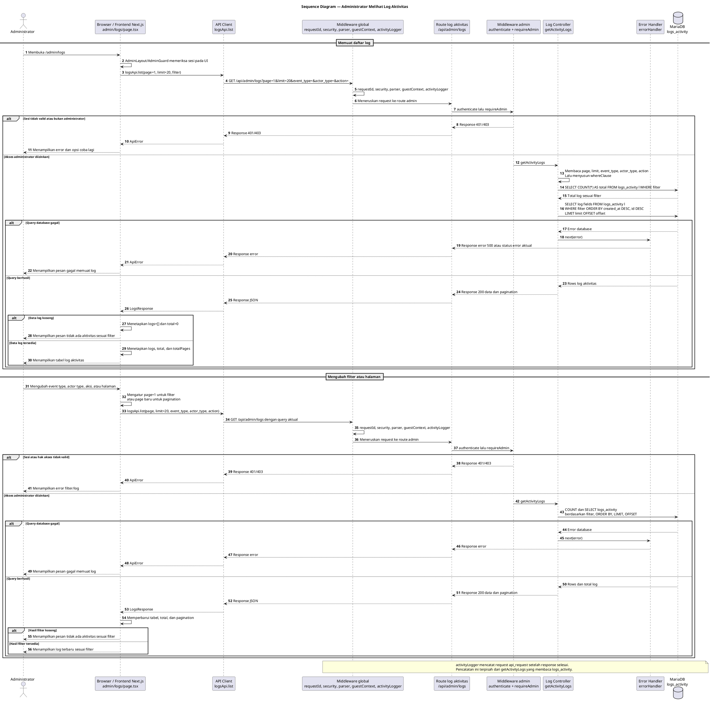

# 11 — Sequence Diagram Melihat Log Aktivitas Administrator

Dokumen ini menggambarkan proses Administrator melihat daftar log aktivitas melalui halaman `apps/web/app/admin/logs/page.tsx`. Diagram berdasarkan pemanggilan `logsApi.list` dari frontend dan endpoint `GET /api/admin/logs`. Endpoint ringkasan log tersedia di backend, tetapi tidak dipanggil oleh halaman yang diperiksa sehingga tidak dimasukkan sebagai alur utama.

## Sequence Diagram — Administrator Melihat Log Aktivitas

## Penjelasan tahapan proses

1. Administrator membuka `/admin/logs`. Halaman dirender melalui `AdminLayout`; perlindungan UI menggunakan mekanisme guard administrator. Perlindungan tersebut dilengkapi pemeriksaan backend pada setiap request.
2. `ActivityLogsPage` memanggil `loadLogs` saat halaman dimuat. Pemanggilan tersebut menggunakan `logsApi.list` dengan `page`, `limit: 20`, `event_type`, `actor_type`, dan `action`.
3. Perubahan event type atau actor type langsung mengatur halaman ke 1 dan memicu pemuatan ulang melalui dependency `loadLogs`. Pencarian aksi disimpan pada `searchInput` dan baru diterapkan ketika tombol Terapkan ditekan atau tombol Enter digunakan. Tombol pagination mengubah `page` dan memicu request berikutnya.
4. API client mengirim `GET /api/admin/logs` dengan query yang dibentuk dari parameter yang tersedia. Frontend halaman ini tidak mengirim parameter tanggal, endpoint, actor public ID, user ID, atau `q` meskipun controller backend mendukung sebagian parameter tersebut.
5. Request melewati middleware global pada `app.ts`, kemudian route log menerapkan `authenticate` dan `requireAdmin` melalui `router.use`. Jika sesi tidak valid atau pengguna bukan administrator, request berhenti pada middleware dan response 401/403 dikembalikan melalui route.
6. `getActivityLogs` membaca dan membatasi parameter `page` serta `limit`. Nilai `page` minimum adalah 1, sedangkan `limit` dibatasi antara 1 dan 100. Frontend menggunakan limit tetap 20.
7. Controller memvalidasi filter `event_type` dan `actor_type` terhadap daftar yang diizinkan, lalu menyusun kondisi SQL untuk `event_type`, `actor_type`, `actor_public_id`, `action`, `endpoint`, `user_id`, rentang tanggal, dan pencarian umum jika parameter tersebut dikirim.
8. Controller menjalankan dua query langsung melalui `pool`: query `COUNT(*)` untuk total dan query daftar log dari tabel `logs_activity`. Data diurutkan dengan `created_at DESC, id DESC`, kemudian dibatasi menggunakan `LIMIT` dan `OFFSET`.
9. Response sukses memiliki `success: true`, `data` berisi baris log, serta `pagination` dengan `total`, `page`, `limit`, dan `total_pages`. Frontend menyimpan data tersebut lalu menampilkan tabel, status loading, pesan data kosong, atau pesan error.
10. `activityLogger` bukan service pembaca log. Middleware tersebut mencatat event `api_request` setelah response selesai, sedangkan `recordAdminAction` digunakan oleh proses mutasi administrator untuk menulis event `admin_action`. Keduanya berbeda dari `getActivityLogs` yang membaca daftar log.

## Endpoint dan HTTP method

| Endpoint | Method | Pemanggil frontend | Fungsi | Parameter aktual dari halaman |
|---|---|---|---|---|
| `/api/admin/logs` | GET | `logsApi.list` | Mengambil daftar log dengan pagination dan filter | `page`, `limit=20`, `event_type`, `actor_type`, `action` |
| `/api/admin/logs/summary` | GET | Tidak ditemukan pada `admin/logs/page.tsx` | Mengambil ringkasan log 7–90 hari berdasarkan controller | Tidak digunakan oleh halaman ini |

## Sumber data dan query database

Sumber data daftar log adalah tabel `logs_activity`. Controller tidak menggunakan `logs.service.ts` atau `logs.repository.ts` untuk membaca daftar; `getActivityLogs` menggunakan `pool.query` secara langsung untuk query count dan query data.

Query daftar mengambil identitas request, aktor, event, action, endpoint, resource, status HTTP, keberhasilan, durasi, payload, error, dan waktu pembuatan. Tabel memiliki foreign key `user_id` ke `users(id)` dengan `ON DELETE SET NULL`, tetapi query daftar log tidak melakukan `JOIN` ke tabel `users`.

## Autentikasi, otorisasi, dan penanganan error

- Route `/api/admin/logs` memasang `authenticate` dan `requireAdmin` untuk seluruh route.
- Validasi request khusus dengan `express-validator` tidak digunakan pada route daftar log.
- Parameter `event_type` dan `actor_type` hanya diterapkan jika termasuk daftar nilai yang diizinkan pada controller.
- Error query diteruskan melalui `next(error)` ke `errorHandler`, kemudian API client mengubah response non-2xx menjadi `ApiError`.
- Jika tabel log belum tersedia, kondisi khusus tersebut diterapkan pada endpoint summary; controller daftar log meneruskan error query ke error handler tanpa cabang khusus yang sama.
- `activityLogger` mencatat request `api_request` setelah response selesai. Pencatatan tersebut tidak boleh disamakan dengan query pembacaan log.

## Batasan dan hasil validasi

- Halaman frontend benar-benar memanggil `GET /api/admin/logs` melalui `logsApi.list`.
- Pagination tersedia dan digunakan dengan `pageSize = 20` pada frontend. Backend membatasi nilai `limit` maksimum 100.
- Filter frontend yang terbukti digunakan hanya event type, actor type, dan action/pencarian aksi. Filter tanggal, endpoint, actor public ID, user ID, dan pencarian umum `q` tersedia pada controller tetapi tidak dipanggil halaman ini.
- Endpoint `/api/admin/logs/summary` tersedia di backend, tetapi tidak ditemukan pemanggilannya pada halaman `apps/web/app/admin/logs/page.tsx`; endpoint tersebut tidak dimasukkan ke alur utama.
- Tidak ditemukan service khusus yang dipanggil `getActivityLogs`; pembacaan dilakukan langsung melalui MariaDB pool.
- Tabel `logs_activity` menyimpan berbagai jenis event, bukan hanya aktivitas administrator. Halaman menampilkan event admin, guest, system, request API, error, dan event lain sesuai filter yang tersedia.
- Tidak ada perubahan source code aplikasi maupun diagram sebelumnya.

## File sumber yang diperiksa

| File | Fungsi atau bukti yang relevan |
|---|---|
| `apps/web/app/admin/logs/page.tsx` | `ActivityLogsPage`, `loadLogs`, filter event/aktor/action, pagination, loading, empty state, error, dan rendering detail log |
| `apps/web/components/AdminLayout.tsx` | Layout panel administrator |
| `apps/web/components/AdminGuard.tsx` | Proteksi dan verifikasi sesi administrator pada UI |
| `apps/web/lib/api.ts` | `LogsQuery`, `logsApi.list`, dan pembentukan query request |
| `apps/web/lib/types.ts` | `LogEventType`, `LogEntry`, dan `LogsResponse` |
| `apps/api/src/app.ts` | Urutan middleware global dan mount `/api/admin/logs` |
| `apps/api/src/modules/logs/logs.routes.ts` | `authenticate`, `requireAdmin`, `GET /`, dan `GET /summary` |
| `apps/api/src/modules/logs/logs.controller.ts` | `getActivityLogs`, `getActivityLogSummary`, filter, count, query data, pagination, dan response |
| `apps/api/src/modules/logs/logs.service.ts` | `recordActivity` dan `recordAdminAction` sebagai pembanding proses penulisan log |
| `apps/api/src/modules/logs/logs.repository.ts` | Mekanisme penyimpanan event ke `logs_activity` sebagai pembanding, bukan pembaca daftar |
| `apps/api/src/middleware/auth.middleware.ts` | Middleware `authenticate` |
| `apps/api/src/middleware/role.middleware.ts` | Middleware `requireAdmin` dan pencatatan access denied |
| `apps/api/src/middleware/activity-logger.middleware.ts` | Pencatatan `api_request` setelah response selesai |
| `apps/api/src/middleware/error.middleware.ts` | Pengubahan error menjadi response HTTP dan JSON error |
| `apps/api/src/database/schema.sql` | Definisi tabel `logs_activity` dan foreign key ke `users` |

