# 12 — Sequence Diagram Pengelolaan Akun Administrator

Dokumen ini menggambarkan pengelolaan akun administrator melalui halaman `apps/web/app/admin/users/page.tsx`. Operasi yang terbukti digunakan frontend adalah memuat daftar, menambah, mengubah, dan menghapus akun administrator. Perubahan password dilakukan sebagai bagian dari operasi update akun; tidak ada pemanggilan halaman ini ke endpoint profil/password pengguna.

## Sequence Diagram — Administrator Mengelola Akun Administrator

```plantuml
@startuml
title Sequence Diagram — Administrator Mengelola Akun Administrator
autonumber

actor "Administrator" as Admin
participant "Browser / Frontend Next.js\nadmin/users/page.tsx" as Web
participant "API Client\nadminAccountsApi" as Client
participant "Middleware global\nrequestId, security, parser, guestContext, activityLogger" as GlobalMW
participant "Route akun admin\n/api/admin/users" as Route
participant "Middleware admin\nauthenticate + requireAdmin" as AdminMW
participant "Validation\nexpress-validator" as Validation
participant "Users Controller\nusers.controller.ts" as Controller
participant "Admin ID allocator\nallocateAdminPublicId" as Allocator
participant "Error Handler\nerrorHandler" as ErrorHandler
database "MariaDB\nusers, admin_counters" as DB
participant "Audit log\nrecordAdminAction" as Audit

== Memuat daftar administrator ==
Admin -> Web: Membuka /admin/users
Web -> Web: AdminLayout/AdminGuard memeriksa sesi pada UI
Web -> Client: adminAccountsApi.list(page=1, limit=10, search, scope=admin)
Client -> GlobalMW: GET /api/admin/users?page=1&limit=10&search=&scope=admin
GlobalMW -> GlobalMW: requestId, security, parser, guestContext, activityLogger
GlobalMW -> Route: Meneruskan request ke route akun admin
Route -> AdminMW: authenticate lalu requireAdmin
alt Sesi tidak valid atau bukan administrator
    AdminMW --> Route: Response 401/403
    Route --> Client: Response 401/403
    Client --> Web: ApiError
    Web --> Admin: Menampilkan error dan opsi coba lagi
else Akses administrator diizinkan
    AdminMW -> Controller: getAllUsers
    Controller -> DB: SELECT COUNT(*) FROM users\nWHERE is_admin = 1 dan search bila ada
    DB --> Controller: Total akun administrator
    Controller -> DB: SELECT id, public_id, name, email, is_admin, timestamps\nORDER BY is_admin DESC, created_at DESC\nLIMIT limit OFFSET offset
    DB --> Controller: Daftar akun administrator
    Controller --> Route: Response 200 data dan pagination
    Route --> Client: Response JSON
    Client --> Web: Daftar akun dan pagination
    alt Data kosong
        Web --> Admin: Menampilkan pesan tidak ada administrator yang cocok
    else Data tersedia
        Web --> Admin: Menampilkan tabel administrator
    end
end

== Menambah administrator ==
Admin -> Web: Memilih Tambah Admin
Web -> Web: Membuka form akun
Admin -> Web: Mengisi nama, email, dan password
Web -> Web: Validasi HTML required, email, maxLength, dan minLength password
alt Validasi frontend gagal
    Web --> Admin: Browser menampilkan pesan validasi
else Input frontend dapat dikirim
    Web -> Client: adminAccountsApi.create(name, email, password)
    Client -> GlobalMW: POST /api/admin/users dengan JSON
    GlobalMW -> GlobalMW: requestId, security, parser, guestContext, activityLogger
    GlobalMW -> Route: Meneruskan request ke route akun admin
    Route -> AdminMW: authenticate lalu requireAdmin
    alt Sesi tidak valid atau bukan administrator
        AdminMW --> Route: Response 401/403
        Route --> Client: Response 401/403
        Client --> Web: ApiError
        Web --> Admin: Menampilkan kegagalan pembuatan akun
    else Akses administrator diizinkan
        AdminMW -> Validation: createUserValidation lalu validate
        alt Validasi backend gagal
            Validation --> Route: Response 422 Validasi gagal
            Route --> Client: Response 422
            Client --> Web: ApiError
            Web --> Admin: Menampilkan pesan validasi
        else Input valid
            Validation -> Controller: createUser
            Controller -> DB: SELECT id FROM users WHERE email = ?
            alt Email sudah terdaftar
                Controller --> Route: Error 409
                Route --> Client: Response konflik email
                Client --> Web: ApiError
                Web --> Admin: Menampilkan email sudah terdaftar
            else Email tersedia
                Controller -> Controller: bcrypt.hash(password, 12)
                Controller -> DB: Membuka transaksi MariaDB
                Controller -> Allocator: allocateAdminPublicId(conn)
                Allocator -> DB: INSERT/UPDATE admin_counters
                Allocator -> DB: SELECT value FOR UPDATE dan cek users.public_id
                DB --> Allocator: public_id admin berikutnya
                Allocator --> Controller: publicId adm_XXXX
                Controller -> DB: INSERT users dengan is_admin = 1
                DB --> Controller: insertId
                Controller -> DB: COMMIT transaksi
                Controller -> DB: SELECT akun baru tanpa password
                DB --> Controller: Data akun administrator
                Controller -> Audit: recordAdminAction CREATE_ADMIN
                Controller --> Route: Response 201 dan data akun
                Route --> Client: Response berhasil
                Client --> Web: Pesan sukses
                Web -> Web: Menutup form dan memuat ulang daftar
                Web --> Admin: Menampilkan administrator baru
            end
        end
    end
end

== Mengubah administrator ==
Admin -> Web: Memilih tombol edit akun
Web -> Web: Mengisi form dari data baris yang sudah dimuat
Admin -> Web: Mengubah nama, email, atau password opsional
Web -> Web: Validasi HTML dan membentuk payload update
Web -> Client: adminAccountsApi.update(id, payload)
Client -> GlobalMW: PUT /api/admin/users/:id dengan JSON
GlobalMW -> GlobalMW: requestId, security, parser, guestContext, activityLogger
GlobalMW -> Route: Meneruskan request ke route akun admin
Route -> AdminMW: authenticate lalu requireAdmin
alt Sesi tidak valid atau bukan administrator
    AdminMW --> Route: Response 401/403
    Route --> Client: Response 401/403
    Client --> Web: ApiError
    Web --> Admin: Menampilkan kegagalan pembaruan akun
else Akses administrator diizinkan
    AdminMW -> Validation: updateUserValidation lalu validate
    alt Validasi backend gagal
        Validation --> Route: Response 422 Validasi gagal
        Route --> Client: Response 422
        Client --> Web: ApiError
        Web --> Admin: Menampilkan pesan validasi
    else Input valid
        Validation -> Controller: updateUser
        Controller -> DB: SELECT akun berdasarkan id
        alt Akun tidak ditemukan
            Controller --> Route: Error 404
            Route --> Client: Response 404
            Client --> Web: ApiError
            Web --> Admin: Menampilkan akun tidak ditemukan
        else Akun ditemukan tetapi bukan admin
            Controller --> Route: Error 400 identitas guest tidak dapat diedit
            Route --> Client: Response 400
            Client --> Web: ApiError
            Web --> Admin: Menampilkan operasi ditolak
        else Akun administrator
            opt Email berubah
                Controller -> DB: SELECT id FROM users\nWHERE email = ? AND id != ?
                alt Email digunakan akun lain
                    Controller --> Route: Error 409
                    Route --> Client: Response konflik email
                    Client --> Web: ApiError
                    Web --> Admin: Menampilkan email sudah digunakan
                end
            end
            opt Password dikirim
                Controller -> Controller: bcrypt.hash(password, 12)
            else Password tidak dikirim
                Controller -> Controller: Mempertahankan password lama
            end
            Controller -> DB: UPDATE users dengan COALESCE name, email, password
            Controller -> DB: SELECT akun hasil pembaruan tanpa password
            DB --> Controller: Data administrator terbaru
            Controller -> Audit: recordAdminAction UPDATE_ADMIN
            Controller --> Route: Response 200 dan data akun
            Route --> Client: Response berhasil
            Client --> Web: Pesan sukses
            Web -> Web: Menutup form dan memuat ulang daftar
            Web --> Admin: Menampilkan perubahan akun
        end
    end
end

== Menghapus administrator ==
Admin -> Web: Memilih hapus akun
alt Akun yang dipilih adalah akun aktif Administrator
    Web -> Web: Menolak operasi tanpa mengirim request
    Web --> Admin: Menampilkan akun yang sedang digunakan tidak dapat dihapus
else Akun lain
    Admin -> Web: Menyetujui window.confirm
    Web -> Client: adminAccountsApi.remove(id)
    Client -> GlobalMW: DELETE /api/admin/users/:id
    GlobalMW -> GlobalMW: requestId, security, parser, guestContext, activityLogger
    GlobalMW -> Route: Meneruskan request ke route akun admin
    Route -> AdminMW: authenticate lalu requireAdmin
    alt Sesi tidak valid atau bukan administrator
        AdminMW --> Route: Response 401/403
        Route --> Client: Response 401/403
        Client --> Web: ApiError
        Web --> Admin: Menampilkan kegagalan penghapusan
    else Akses administrator diizinkan
        AdminMW -> Controller: deleteUser
        alt ID sama dengan req.user.id
            Controller --> Route: Error 400 tidak dapat menghapus akun sendiri
            Route --> Client: Response 400
            Client --> Web: ApiError
            Web --> Admin: Menampilkan operasi ditolak
        else ID akun lain
            Controller -> DB: SELECT akun berdasarkan id
            alt Akun tidak ditemukan
                Controller --> Route: Error 404
                Route --> Client: Response 404
                Client --> Web: ApiError
                Web --> Admin: Menampilkan akun tidak ditemukan
            else Akun ditemukan tetapi bukan admin
                Controller --> Route: Error 400 identitas guest tidak dapat dihapus
                Route --> Client: Response 400
                Client --> Web: ApiError
                Web --> Admin: Menampilkan operasi ditolak
            else Akun administrator
                Controller -> DB: DELETE FROM users WHERE id = ?
                Controller -> Audit: recordAdminAction DELETE_ADMIN
                Controller --> Route: Response 200
                Route --> Client: Response berhasil
                Client --> Web: Pesan sukses
                Web -> Web: Memuat ulang daftar administrator
                Web --> Admin: Menampilkan daftar terbaru
            end
        end
    end
end
@enduml
```

## Penjelasan tahapan proses

1. Halaman `/admin/users` menggunakan `AdminLayout` dan konteks/guard autentikasi administrator. Daftar akun dimuat melalui `loadAccounts` dengan `page`, `limit: 10`, `search`, dan `scope: 'admin'`.
2. Backend `getAllUsers` hanya menampilkan akun dengan `is_admin = 1` pada alur frontend ini. Controller menjalankan query count dan query daftar, lalu mengurutkan berdasarkan `is_admin DESC, created_at DESC` serta menggunakan `LIMIT` dan `OFFSET`.
3. Pencarian berubah langsung ketika input berubah. `handleSearchChange` mengatur `search` dan mengembalikan `page` ke 1, sehingga dependency `loadAccounts` memicu request baru. Pagination juga memicu pemuatan ulang ketika `page` berubah.
4. Tambah administrator memakai `POST /api/admin/users`. Backend memeriksa email duplikat, melakukan `bcrypt.hash(password, 12)`, mengalokasikan `public_id` berurutan melalui `allocateAdminPublicId`, lalu memasukkan akun dengan `is_admin = 1` dalam transaksi MariaDB.
5. Jika proses transaksi pembuatan gagal, controller melakukan rollback dan melepaskan koneksi. Source code tidak menunjukkan mekanisme rollback untuk audit setelah transaksi berhasil; audit `CREATE_ADMIN` dipanggil setelah commit.
6. Edit administrator memakai `PUT /api/admin/users/:id`. Field yang dapat dikirim frontend adalah `name`, `email`, dan password opsional. Jika password baru dikirimkan, controller melakukan hash dengan bcrypt dan memperbarui kolom password; jika tidak dikirimkan, password lama dipertahankan melalui penggunaan `COALESCE`. `is_admin` tidak diubah melalui endpoint update.
7. Controller update menolak identitas guest, memeriksa email duplikat jika email berubah, lalu memperbarui data dengan `COALESCE`. Tidak ditemukan larangan mengubah akun sendiri; larangan khusus terhadap akun sendiri hanya diterapkan pada penghapusan.
8. Penghapusan diblokir di frontend jika ID akun sama dengan ID administrator yang sedang login, kemudian dikonfirmasi dengan `window.confirm`. Backend juga mengulangi pemeriksaan tersebut melalui `req.user!.id`, sehingga request penghapusan akun sendiri ditolak dengan error 400.
9. Semua operasi mutasi berhasil mencatat audit menggunakan `recordAdminAction`: `CREATE_ADMIN`, `UPDATE_ADMIN`, dan `DELETE_ADMIN`. Password tidak dikirim sebagai nilai mentah dalam payload audit; update hanya mencatat `password_changed: true`.
10. `GET /api/admin/users/:id` tersedia di backend, tetapi halaman admin users yang diperiksa tidak memanggilnya. Tidak ditemukan fitur aktif/nonaktif akun, perubahan role melalui UI, atau endpoint khusus perubahan password yang dipanggil halaman ini.

## Endpoint dan HTTP method

| Endpoint | Method | Dipanggil frontend | Fungsi |
|---|---|---|---|
| `/api/admin/users` | GET | Ya, `adminAccountsApi.list` | Daftar akun dengan pagination, pencarian, dan scope |
| `/api/admin/users` | POST | Ya, `adminAccountsApi.create` | Membuat akun administrator |
| `/api/admin/users/:id` | PUT | Ya, `adminAccountsApi.update` | Mengubah nama, email, dan password opsional |
| `/api/admin/users/:id` | DELETE | Ya, `adminAccountsApi.remove` | Menghapus akun administrator selain akun aktif |
| `/api/admin/users/:id` | GET | Tidak ditemukan pemanggilan frontend | Detail akun dan statistik favorit/kuis pada controller |

## Interaksi database

Tabel utama adalah `users`, dengan kolom `id`, `public_id`, `name`, `email`, `password`, `is_admin`, dan timestamp. `email` dan `public_id` memiliki unique key. Schema menetapkan bahwa admin memiliki nama, email, dan password, sedangkan guest dianonimkan dan tidak memiliki ketiga nilai tersebut.

Pembuatan akun juga menggunakan tabel `admin_counters` melalui `allocateAdminPublicId`. Counter dan insert user dilakukan dalam transaksi yang sama. Query daftar hanya mengambil field akun yang aman ditampilkan dan tidak mengambil password.

## Autentikasi, otorisasi, validasi, dan audit

- Route `/api/admin/users` memasang `authenticate` dan `requireAdmin` untuk semua method.
- Validasi create memeriksa nama, format email, password minimal 8 karakter, serta kombinasi huruf besar, huruf kecil, dan angka.
- Validasi update membuat nama, email, dan password bersifat opsional, tetapi jika dikirim tetap diperiksa.
- Middleware `validate` mengembalikan response HTTP 422 jika validasi gagal.
- Controller menggunakan 400 untuk scope/identitas guest/akun sendiri, 404 untuk akun tidak ditemukan, dan 409 untuk email duplikat.
- Audit administrator dicatat melalui `recordAdminAction` setelah operasi database berhasil.
- Tidak ditemukan fitur status aktif/nonaktif atau perubahan `is_admin` melalui halaman dan endpoint admin users yang diperiksa.

## Batasan dan hasil validasi

- Frontend benar-benar menggunakan CRUD akun administrator: list, create, update, dan delete.
- Operasi delete akun sendiri diblokir di frontend dan backend.
- Operasi update akun sendiri tidak diblokir oleh source code yang diperiksa.
- Endpoint profil `/api/users/profile` dan `/api/users/password` bukan bagian dari alur halaman admin users dan tidak dipanggil frontend halaman tersebut.
- Endpoint GET detail admin tersedia di backend tetapi tidak dipanggil halaman; edit menggunakan data akun dari baris daftar.
- Tidak ditemukan service/repository khusus untuk akun admin selain helper `allocateAdminPublicId`; controller menggunakan `pool.query` langsung.
- Tidak ditemukan fitur mengaktifkan/menonaktifkan akun, mengubah role dari UI, atau filter selain pencarian dan scope `admin` yang dikirim halaman.
- Tidak ada perubahan source code aplikasi maupun diagram sebelumnya.

## File sumber yang diperiksa

| File | Fungsi atau bukti yang relevan |
|---|---|
| `apps/web/app/admin/users/page.tsx` | `loadAccounts`, `openCreate`, `openEdit`, `handleSubmit`, `handleDelete`, pencarian, pagination, form, konfirmasi, loading, error, dan empty state |
| `apps/web/components/AdminLayout.tsx` | Layout panel administrator |
| `apps/web/components/AdminGuard.tsx` | Proteksi dan verifikasi sesi administrator pada UI |
| `apps/web/context/AuthContext.tsx` | Sumber user aktif yang dipakai untuk memblokir penghapusan akun sendiri |
| `apps/web/lib/api.ts` | `AdminAccountsQuery` dan `adminAccountsApi.list/create/update/remove` |
| `apps/web/lib/types.ts` | Tipe `AdminAccount` |
| `apps/api/src/app.ts` | Urutan middleware global dan mount `/api/admin/users` |
| `apps/api/src/modules/users/users.routes.ts` | Route GET, POST, PUT, DELETE serta `authenticate`/`requireAdmin` |
| `apps/api/src/modules/users/users.controller.ts` | `getAllUsers`, `getUserById`, `createUser`, `updateUser`, `deleteUser` |
| `apps/api/src/modules/users/users.validation.ts` | `createUserValidation` dan `updateUserValidation` |
| `apps/api/src/modules/users/admin-sequence.ts` | `allocateAdminPublicId` dan transaksi counter admin |
| `apps/api/src/middleware/auth.middleware.ts` | Middleware `authenticate` |
| `apps/api/src/middleware/role.middleware.ts` | Middleware `requireAdmin` |
| `apps/api/src/middleware/validation.middleware.ts` | Response validasi HTTP 422 |
| `apps/api/src/modules/logs/logs.service.ts` | `recordAdminAction` untuk audit akun administrator |
| `apps/api/src/database/schema.sql` | Tabel `users`, unique key, constraint identitas, dan `admin_counters` |

