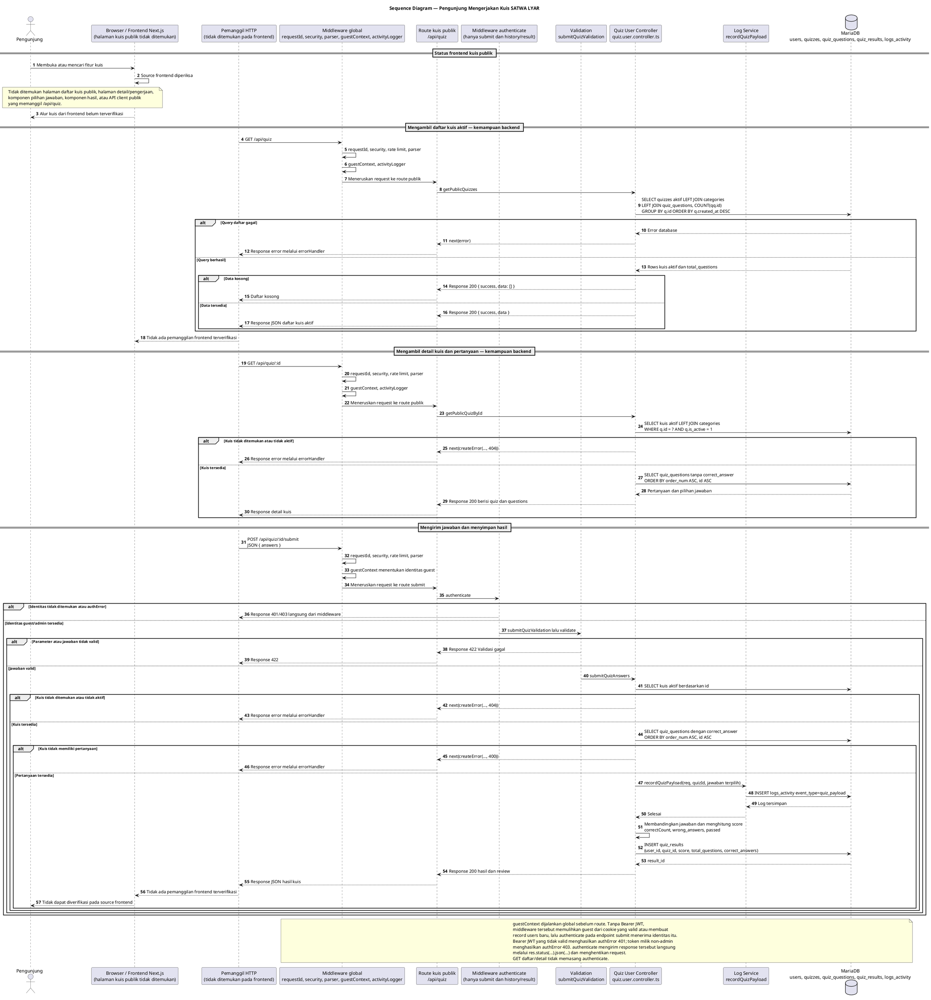

# 13 — Sequence Diagram Pengunjung Mengerjakan Kuis SATWA LYAR

Dokumen ini mendokumentasikan hasil pemeriksaan terhadap fitur kuis publik SATWA LYAR. Backend menyediakan endpoint untuk daftar kuis aktif, detail pertanyaan, dan pengiriman jawaban. Namun, pada source code frontend yang diperiksa tidak ditemukan halaman kuis publik, komponen pengerjaan kuis, atau API client yang memanggil endpoint `/api/quiz`. Oleh karena itu, alur end-to-end Pengunjung dari browser belum dapat dinyatakan sebagai fitur frontend yang telah digunakan.

Diagram di bawah tetap menggambarkan kontrak backend yang benar-benar tersedia apabila endpoint publik dipanggil oleh suatu client HTTP. Participant client pada bagian backend diberi keterangan bahwa pemanggilnya tidak ditemukan pada repository frontend.

## Sequence Diagram — Pengunjung Mengerjakan Kuis

## Penjelasan tahapan proses

1. Pemeriksaan terhadap `apps/web/app` dan `apps/web/lib` tidak menemukan halaman publik untuk daftar atau pengerjaan kuis. Satu-satunya halaman frontend kuis yang ditemukan adalah `apps/web/app/admin/quiz/page.tsx`, yang memakai endpoint admin dan hanya ditujukan untuk Administrator.
2. Backend mendaftarkan route pengguna pada `/api/quiz`. Endpoint `GET /api/quiz` mengambil kuis aktif saja (`q.is_active = 1`), menggabungkan kategori dan pertanyaan, menghitung `total_questions`, lalu mengurutkan berdasarkan `q.created_at DESC`.
3. Endpoint `GET /api/quiz/:id` mengambil metadata kuis aktif dan pertanyaan berdasarkan `order_num ASC, id ASC`. Query publik sengaja tidak mengambil `correct_answer`, sehingga kunci jawaban tidak dikirim sebelum pengiriman jawaban.
4. Endpoint `POST /api/quiz/:id/submit` menerima body `answers`, berupa array berisi `question_id` dan `answer`. Route memasang `authenticate`, `submitQuizValidation`, dan `validate` sebelum `submitQuizAnswers`.
5. `guestContext` merupakan middleware global dan berjalan sebelum route. Guest dipulihkan dari cookie yang valid atau dibuat sebagai row baru pada `users`. Jika Bearer JWT tidak valid, middleware menetapkan `authError` 401; jika token bukan milik administrator, middleware menetapkan `authError` 403. `authenticate` mengirim response 401/403 langsung melalui `res.status(...).json(...)` dan menghentikan request, sehingga error ini tidak diteruskan ke `errorHandler`. Tanpa error tersebut, `authenticate` hanya mensyaratkan adanya `req.user` dan tidak memanggil `requireAdmin`, sehingga guest yang telah diidentifikasi dapat mengirim jawaban tanpa login administrator.
6. Controller memeriksa kuis aktif, mengambil pertanyaan beserta `correct_answer`, membentuk map jawaban berdasarkan `question_id`, lalu membandingkan jawaban. Skor dihitung di backend dengan rumus `Math.round((correctCount / totalQuestions) * 100)` dan dinyatakan lulus apabila `score >= 70`.
7. Sebelum penyimpanan hasil, controller memanggil `recordQuizPayload`. Service tersebut mencatat pilihan jawaban pada `logs_activity` sebagai `event_type = 'quiz_payload'`; kunci jawaban tidak dicatat ke payload log.
8. Hasil pengerjaan disimpan ke `quiz_results` dengan `user_id`, `quiz_id`, `score`, `total_questions`, `correct_answers`, dan `completed_at`. Response sukses berisi `result_id`, ringkasan nilai, status `passed`, serta `review` yang memuat jawaban pengguna, jawaban benar, dan status benar/salah.
9. Karena tidak ada halaman dan API client publik yang ditemukan pada frontend, penerimaan response dan penampilan hasil oleh browser belum dapat diverifikasi. Diagram tidak menyatakan bahwa UI pengunjung untuk proses tersebut telah tersedia.

## Endpoint dan HTTP method

| Endpoint | Method | Status pemanggilan frontend | Fungsi dan parameter aktual |
|---|---|---|---|
| `/api/quiz` | GET | Tidak ditemukan pemanggilan frontend | Daftar kuis aktif; mendukung `category_id` dan `zone`/`category` pada controller |
| `/api/quiz/:id` | GET | Tidak ditemukan pemanggilan frontend | Detail kuis aktif dan pertanyaan tanpa `correct_answer` |
| `/api/quiz/:id/submit` | POST | Tidak ditemukan pemanggilan frontend | Mengirim `answers[{ question_id, answer }]`, menghitung nilai, mencatat payload, dan menyimpan hasil |
| `/api/quiz/history` | GET | Tidak ditemukan pemanggilan frontend | Riwayat kuis untuk identitas terautentikasi; bukan bagian dari alur pengerjaan yang terverifikasi |
| `/api/quiz/results/:id` | GET | Tidak ditemukan pemanggilan frontend | Detail hasil untuk pemilik hasil atau admin; bukan bagian dari alur frontend yang ditemukan |

## Interaksi database

- `GET /api/quiz` membaca `quizzes`, `categories`, dan `quiz_questions` melalui `LEFT JOIN`. Hanya kuis aktif yang dipilih dan jumlah pertanyaan dihitung dengan `COUNT(qq.id)`.
- `GET /api/quiz/:id` membaca metadata kuis dan kategori, kemudian membaca `quiz_questions` tanpa kolom `correct_answer`.
- `POST /api/quiz/:id/submit` membaca kuis aktif dan pertanyaan lengkap dengan `correct_answer`, menulis payload jawaban ke `logs_activity`, lalu menulis hasil ke `quiz_results`.
- `users` menyimpan identitas guest yang dibuat oleh `guestContext`. `quiz_results.user_id` mereferensikan `users(id)` dengan `ON DELETE CASCADE`.
- `quiz_questions.quiz_id` mereferensikan `quizzes(id)` dengan `ON DELETE CASCADE`. Relasi ini tidak memicu request frontend tambahan pada submit.

## Autentikasi, otorisasi, validasi, dan identitas guest

- Middleware global berjalan dalam urutan `requestId`, Helmet/CORS, rate limit, parser, Morgan, `guestContext`, lalu `activityLogger`.
- Endpoint daftar dan detail kuis publik tidak memasang `authenticate` atau `optionalAuthenticate` pada route.
- Endpoint submit memasang `authenticate`, tetapi tidak memasang `requireAdmin`. `authenticate` menerima identitas guest maupun admin selama `guestContext` telah mengisi `req.user`.
- `submitQuizValidation` memvalidasi ID kuis sebagai bilangan positif, `answers` sebagai array minimal satu elemen, `question_id` sebagai bilangan positif, dan jawaban sebagai salah satu dari A, B, C, atau D tanpa membedakan huruf besar/kecil.
- Validasi gagal menghasilkan HTTP 422 melalui middleware `validate`. Kuis tidak ditemukan menghasilkan 404, sedangkan kuis tanpa pertanyaan menghasilkan 400.
- Tidak ditemukan validasi bahwa setiap pertanyaan harus dijawab tepat satu kali atau bahwa `question_id` harus berasal dari kuis yang sama. Controller menggunakan map jawaban dan mengambil kebenaran dari seluruh pertanyaan pada kuis.

## Batasan dan hasil validasi

- Tidak ditemukan halaman frontend publik, API client publik, komponen pertanyaan, komponen pilihan jawaban, atau komponen hasil kuis pada repository yang diperiksa.
- `apps/web/lib/api.ts` hanya memiliki `quizApi` untuk endpoint `/api/admin/quiz`; tidak ditemukan fungsi client untuk `/api/quiz`.
- Endpoint publik backend untuk daftar, detail, dan submit kuis benar-benar tersedia, tetapi penggunaannya dari frontend belum terbukti.
- Pengunjung tidak diwajibkan menjadi administrator untuk submit menurut route aktual; `authenticate` menerima guest yang dibuat atau dipulihkan oleh `guestContext`.
- Jawaban benar disembunyikan pada detail kuis publik dan baru dikembalikan pada response submit melalui `review`.
- Skor dihitung dan hasil disimpan di backend, bukan dihitung oleh frontend. Penyimpanan dilakukan pada `quiz_results`.
- Payload jawaban juga dicatat pada `logs_activity` melalui `recordQuizPayload`. Pencatatan tersebut berbeda dari `activityLogger` yang mencatat request `api_request` setelah response selesai.
- Endpoint history dan detail hasil tersedia di backend, tetapi tidak dimasukkan sebagai alur utama karena tidak ditemukan pemanggil frontend publik.
- Dokumen ini dibuat tanpa mengubah source code aplikasi maupun diagram sebelumnya.

## File sumber yang diperiksa

| File | Fungsi atau bukti relevan |
|---|---|
| `apps/api/src/app.ts` | Urutan middleware global dan mount `/api/quiz` |
| `apps/api/src/modules/quiz/quiz.user.routes.ts` | Route publik daftar/detail, submit, history, dan result; middleware `authenticate` serta validasi submit |
| `apps/api/src/modules/quiz/quiz.user.controller.ts` | `getPublicQuizzes`, `getPublicQuizById`, `submitQuizAnswers`, query, perhitungan skor, penyimpanan hasil, dan response |
| `apps/api/src/modules/quiz/quiz.user.validation.ts` | `submitQuizValidation` untuk ID dan array jawaban |
| `apps/api/src/middleware/guest-context.middleware.ts` | Pemulihan atau pembuatan identitas guest dan cookie |
| `apps/api/src/middleware/auth.middleware.ts` | Implementasi `authenticate` dan `optionalAuthenticate` |
| `apps/api/src/middleware/validation.middleware.ts` | Response validasi HTTP 422 |
| `apps/api/src/middleware/activity-logger.middleware.ts` | Pencatatan request `api_request` setelah response selesai |
| `apps/api/src/middleware/error.middleware.ts` | Konversi error controller menjadi response JSON |
| `apps/api/src/modules/logs/logs.service.ts` | `recordQuizPayload` dan pencatatan payload jawaban |
| `apps/api/src/database/schema.sql` | Tabel `users`, `quizzes`, `quiz_questions`, `quiz_results`, dan `logs_activity` |
| `apps/web/app/admin/quiz/page.tsx` | Satu-satunya halaman frontend kuis yang ditemukan; hanya alur admin |
| `apps/web/lib/api.ts` | `quizApi` yang hanya memanggil endpoint admin kuis |
| `apps/web/lib/types.ts` | Tipe `Quiz` dan `QuizQuestion` yang digunakan frontend admin |

